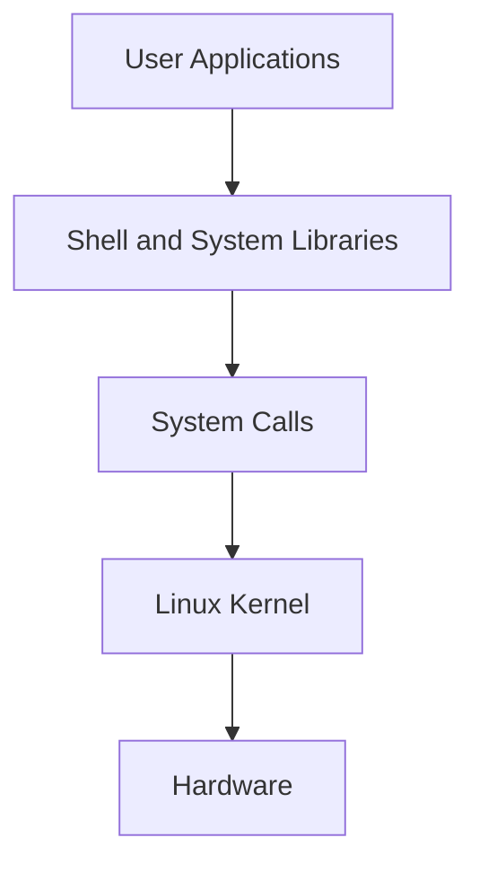
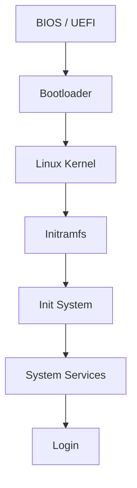
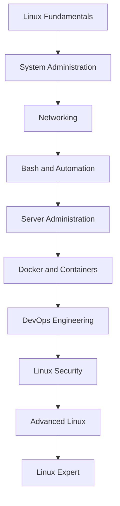

# Linux — Полное руководство

Практическое руководство по работе с Linux: от основ командной строки до системного администрирования, автоматизации, сетевых технологий и информационной безопасности.

## Содержание

- [1. Введение в Linux](#1-введение-в-linux)
- [2. Дистрибутивы Linux](#2-дистрибутивы-linux)
- [3. Установка Linux](#3-установка-linux)
- [4. Архитектура Linux](#4-архитектура-linux)
- [5. Файловая система](#5-файловая-система)
- [6. Терминал и командная строка](#6-терминал-и-командная-строка)
- [7. Работа с файлами и каталогами](#7-работа-с-файлами-и-каталогами)
- [8. Поиск файлов и текста](#8-поиск-файлов-и-текста)
- [9. Пользователи и группы](#9-пользователи-и-группы)
- [10. Права доступа](#10-права-доступа)
- [11. Управление пакетами](#11-управление-пакетами)
- [12. Управление процессами](#12-управление-процессами)
- [13. Системные службы](#13-системные-службы)
- [14. Сетевые технологии](#14-сетевые-технологии)
- [15. SSH](#15-ssh)
- [16. Архивирование и сжатие](#16-архивирование-и-сжатие)
- [17. Работа с дисками](#17-работа-с-дисками)
- [18. Bash Scripting](#18-bash-scripting)
- [19. Автоматизация задач](#19-автоматизация-задач)
- [20. Переменные окружения](#20-переменные-окружения)
- [21. Перенаправление и конвейеры](#21-перенаправление-и-конвейеры)
- [22. Текстовые редакторы](#22-текстовые-редакторы)
- [23. Информационная безопасность](#23-информационная-безопасность)
- [24. Системные журналы](#24-системные-журналы)
- [25. Мониторинг системы](#25-мониторинг-системы)
- [26. Веб-сервер Nginx](#26-веб-сервер-nginx)
- [27. Docker](#27-docker)
- [28. Git и GitHub](#28-git-и-github)
- [29. Резервное копирование](#29-резервное-копирование)
- [30. Ядро Linux](#30-ядро-linux)
- [31. Диагностика и устранение ошибок](#31-диагностика-и-устранение-ошибок)
- [32. Горячие клавиши](#32-горячие-клавиши)
- [33. Практические задания](#33-практические-задания)
- [34. Дорожная карта обучения](#34-дорожная-карта-обучения)
- [35. Полезные ресурсы](#35-полезные-ресурсы)

---

## 1. Введение в Linux

Linux — свободное ядро операционной системы с открытым исходным кодом, созданное Линусом Торвальдсом в 1991 году.

Операционные системы на базе Linux широко используются в серверной инфраструктуре, разработке программного обеспечения, облачных вычислениях и информационной безопасности.

### Где используется Linux?

- Веб-серверы
- Суперкомпьютеры
- Облачные платформы
- Центры обработки данных
- DevOps-инфраструктура
- Информационная безопасность
- Искусственный интеллект
- Встраиваемые системы
- Мобильные устройства
- Персональные компьютеры
- Сетевое оборудование
- Контейнеризация

### Преимущества Linux

- Открытый исходный код
- Гибкость настройки
- Стабильность
- Высокая производительность
- Развитая система безопасности
- Возможность автоматизации
- Большое сообщество разработчиков
- Поддержка различных архитектур процессоров

---

## 2. Дистрибутивы Linux

Дистрибутив — готовая операционная система, включающая ядро Linux, системные утилиты, пакетный менеджер и дополнительное программное обеспечение.

| Дистрибутив | Назначение | Уровень |
|---|---|---|
| Ubuntu | Разработка и серверы | Beginner |
| Linux Mint | Повседневное использование | Beginner |
| Debian | Стабильные серверы | Intermediate |
| Fedora | Разработка | Intermediate |
| Rocky Linux | Корпоративные серверы | Intermediate |
| AlmaLinux | Корпоративная инфраструктура | Intermediate |
| Arch Linux | Гибкая настройка системы | Advanced |
| Kali Linux | Аудит безопасности | Advanced |
| Parrot OS | Безопасность и приватность | Advanced |
| Alpine Linux | Контейнеры и минимальные системы | Advanced |
| Gentoo | Глубокая настройка системы | Expert |
| NixOS | Декларативное управление системой | Advanced |
| openSUSE | Разработка и администрирование | Intermediate |
| RHEL | Корпоративная инфраструктура | Professional |

### Рекомендации

- Для начинающих — Ubuntu или Linux Mint.
- Для разработчиков — Ubuntu или Fedora.
- Для серверов — Debian, Ubuntu Server или Rocky Linux.
- Для DevOps — Ubuntu Server, Debian или Alpine Linux.
- Для специалистов по безопасности — Kali Linux.
- Для глубокого изучения Linux — Arch Linux или Gentoo.

---

## 3. Установка Linux

### Способы установки

1. Установка на физический компьютер.
2. Установка рядом с Windows (Dual Boot).
3. Использование виртуальной машины.
4. Использование Windows Subsystem for Linux (WSL).
5. Использование облачного VPS-сервера.
6. Запуск с Live USB.

Перед установкой на физический диск необходимо создать резервную копию важных данных.

### Установка через WSL

Откройте PowerShell от имени администратора:

```powershell
wsl --install
```

Просмотр доступных дистрибутивов:

```powershell
wsl --list --online
```

Установка Ubuntu:

```powershell
wsl --install -d Ubuntu
```

Просмотр установленных систем:

```powershell
wsl --list --verbose
```

Обновление WSL:

```powershell
wsl --update
```

### Первоначальная настройка Ubuntu

```bash
sudo apt update
sudo apt upgrade
```

Установка основных инструментов:

```bash
sudo apt install curl wget git vim nano htop tree \
    build-essential unzip openssh-client
```

Проверка версии системы:

```bash
cat /etc/os-release
```

---

## 4. Архитектура Linux



### Основные компоненты

| Компонент | Описание |
|---|---|
| Kernel | Ядро операционной системы |
| Shell | Командный интерпретатор |
| System Libraries | Системные библиотеки |
| System Utilities | Системные утилиты |
| Init System | Управление запуском системы |
| File System | Организация хранения данных |
| User Space | Пространство пользовательских процессов |
| Kernel Space | Пространство ядра |

### Процесс загрузки Linux



---

## 5. Файловая система

В Linux используется иерархическая файловая система, начинающаяся с корневого каталога `/`.

```text
/
├── bin
├── boot
├── dev
├── etc
├── home
├── lib
├── media
├── mnt
├── opt
├── proc
├── root
├── run
├── sbin
├── srv
├── sys
├── tmp
├── usr
└── var
```

| Каталог | Назначение |
|---|---|
| `/` | Корневой каталог |
| `/bin` | Основные исполняемые файлы |
| `/boot` | Файлы загрузки системы |
| `/dev` | Файлы устройств |
| `/etc` | Конфигурационные файлы |
| `/home` | Домашние каталоги пользователей |
| `/lib` | Системные библиотеки |
| `/media` | Съёмные носители |
| `/mnt` | Временные точки монтирования |
| `/opt` | Дополнительное ПО |
| `/proc` | Виртуальная информация о процессах и ядре |
| `/root` | Домашний каталог root |
| `/run` | Данные работающей системы |
| `/sbin` | Системные исполняемые файлы |
| `/srv` | Данные системных служб |
| `/sys` | Интерфейс к объектам ядра |
| `/tmp` | Временные файлы |
| `/usr` | Программы и библиотеки |
| `/var` | Изменяемые данные и журналы |

В современных дистрибутивах некоторые каталоги, например `/bin` и `/sbin`, могут быть символическими ссылками на соответствующие каталоги внутри `/usr`.

### Типы файловых систем

- EXT4
- XFS
- Btrfs
- ZFS
- FAT32
- exFAT
- NTFS
- F2FS
- tmpfs

---

## 6. Терминал и командная строка

Терминал позволяет взаимодействовать с операционной системой через текстовые команды.

### Популярные командные оболочки

- Bash
- Zsh
- Fish
- Dash
- Ksh

Проверка оболочки пользователя:

```bash
echo "$SHELL"
```

Общий синтаксис команды:

```text
command [options] [arguments]
```

Пример:

```bash
ls -la /home
```

### Основные команды

| Команда | Описание |
|---|---|
| `pwd` | Текущий каталог |
| `ls` | Список файлов |
| `cd` | Переход между каталогами |
| `clear` | Очистка терминала |
| `whoami` | Текущий пользователь |
| `hostname` | Имя компьютера |
| `date` | Дата и время |
| `cal` | Календарь |
| `history` | История команд |
| `uname` | Информация о ядре |
| `man` | Документация команды |
| `which` | Поиск исполняемого файла |
| `type` | Определение типа команды |
| `exit` | Завершение сеанса |

Получение справки:

```bash
man ls
ls --help
help cd
```

Некоторые команды требуют установки дополнительных пакетов.

---

## 7. Работа с файлами и каталогами

### Навигация

```bash
pwd
ls
ls -l
ls -a
ls -lh
ls -lah
```

```bash
cd /etc
cd ..
cd ~
cd -
cd /
```

### Создание файлов

```bash
touch file.txt
touch file1.txt file2.txt
```

### Создание каталогов

```bash
mkdir projects
mkdir -p projects/backend/src
```

### Копирование

```bash
cp file.txt backup.txt
cp -r projects projects-backup
cp -i file.txt /tmp/
```

### Перемещение и переименование

```bash
mv file.txt new-file.txt
mv new-file.txt /tmp/
```

### Удаление

```bash
rm file.txt
rm -i file.txt
rmdir empty-directory
rm -r projects-backup
```

> Внимание: команда `rm` обычно удаляет файлы без перемещения в корзину. Всегда проверяйте путь перед рекурсивным удалением.

### Просмотр содержимого

```bash
cat file.txt
less file.txt
more file.txt
head file.txt
tail file.txt
```

Просмотр последних 20 строк:

```bash
tail -n 20 file.txt
```

Наблюдение за изменениями файла:

```bash
tail -f application.log
```

### Информация о файлах

```bash
file file.txt
stat file.txt
wc -l file.txt
wc -w file.txt
```

### Символические и жёсткие ссылки

```bash
ln file.txt hardlink.txt
ln -s file.txt symlink.txt
```

- Hard link — дополнительное имя того же inode.
- Symbolic link — ссылка на путь другого файла.

---

## 8. Поиск файлов и текста

### find

Поиск по имени:

```bash
find /home -name "*.txt"
```

Поиск без учёта регистра:

```bash
find /home -iname "*.pdf"
```

Поиск каталогов:

```bash
find /home -type d -name "projects"
```

Поиск файлов размером более 100 МБ:

```bash
find /home -type f -size +100M
```

Поиск недавно изменённых файлов:

```bash
find /home -type f -mtime -7
```

### grep

```bash
grep "error" application.log
grep -i "error" application.log
grep -n "error" application.log
grep -r "localhost" ./src
grep -v "debug" application.log
```

Использование регулярных выражений:

```bash
grep -E "error|warning" application.log
```

### locate

```bash
locate nginx.conf
```

Обновление базы поиска:

```bash
sudo updatedb
```

Для использования `locate` может потребоваться установка пакета `plocate`.

### Дополнительные инструменты

```bash
which python3
whereis bash
command -v git
```

---

## 9. Пользователи и группы

Linux является многопользовательской операционной системой.

### Типы пользователей

- Root — суперпользователь.
- System User — системная учётная запись.
- Regular User — обычный пользователь.

### Просмотр информации

```bash
whoami
id
who
w
groups
last
```

### Создание пользователя

В Ubuntu и Debian:

```bash
sudo adduser developer
```

Универсальный низкоуровневый вариант:

```bash
sudo useradd -m -s /bin/bash developer
sudo passwd developer
```

### Изменение пароля

```bash
passwd
sudo passwd developer
```

### Добавление в группу

Ubuntu и Debian:

```bash
sudo usermod -aG sudo developer
```

Fedora и RHEL:

```bash
sudo usermod -aG wheel developer
```

### Управление группами

```bash
sudo groupadd developers
sudo usermod -aG developers developer
getent group developers
```

### Переключение пользователя

```bash
su - developer
sudo -i
```

### Удаление пользователя

```bash
sudo userdel developer
```

Удаление вместе с домашним каталогом:

```bash
sudo userdel -r developer
```

> Перед удалением пользователя убедитесь, что его данные сохранены.

### Системные файлы

| Файл | Назначение |
|---|---|
| `/etc/passwd` | Информация о пользователях |
| `/etc/shadow` | Хеши паролей и параметры их действия |
| `/etc/group` | Информация о группах |
| `/etc/sudoers` | Правила использования sudo |

Редактирование правил sudo:

```bash
sudo visudo
```

---

## 10. Права доступа

Linux использует три основные категории доступа:

- Owner — владелец.
- Group — группа.
- Others — остальные пользователи.

### Типы разрешений

| Символ | Значение | Число |
|---|---|---|
| `r` | Чтение | 4 |
| `w` | Запись | 2 |
| `x` | Выполнение | 1 |
| `-` | Нет разрешения | 0 |

Пример:

```text
-rwxr-xr--
```

```text
Owner:  rwx = 7
Group:  r-x = 5
Others: r-- = 4
```

### chmod

```bash
chmod 755 script.sh
chmod 644 file.txt
chmod 600 private.key
chmod 700 private-directory
```

Символьный режим:

```bash
chmod u+x script.sh
chmod g+w file.txt
chmod o-r file.txt
```

### chown

```bash
sudo chown developer file.txt
sudo chown developer:developers file.txt
```

### chgrp

```bash
sudo chgrp developers file.txt
```

### Популярные комбинации

| Права | Назначение |
|---|---|
| 600 | Приватные файлы и ключи |
| 644 | Обычные файлы |
| 640 | Файлы с ограниченным доступом |
| 700 | Приватные каталоги и скрипты |
| 755 | Исполняемые файлы и каталоги |
| 750 | Каталоги с ограниченным доступом |
| 777 | Полный доступ для всех, обычно не рекомендуется |

### Специальные разрешения

- SUID
- SGID
- Sticky Bit

```bash
chmod g+s shared-directory
chmod +t shared-directory
```

### ACL

Расширенное управление правами:

```bash
getfacl file.txt
setfacl -m u:developer:rw file.txt
setfacl -x u:developer file.txt
```

### umask

```bash
umask
umask 027
```

`umask` определяет, какие разрешения исключаются при создании новых файлов и каталогов.

---

## 11. Управление пакетами

### Debian / Ubuntu — APT

```bash
sudo apt update
sudo apt upgrade
sudo apt install nginx
sudo apt remove nginx
sudo apt purge nginx
sudo apt autoremove
```

```bash
apt search nginx
apt show nginx
apt list --installed
```

Установка локального DEB-пакета:

```bash
sudo apt install ./package.deb
```

### Fedora / RHEL — DNF

```bash
sudo dnf check-update
sudo dnf upgrade
sudo dnf install nginx
sudo dnf remove nginx
dnf search nginx
```

### Arch Linux — Pacman

```bash
sudo pacman -Syu
sudo pacman -S nginx
sudo pacman -R nginx
pacman -Ss nginx
```

### Alpine Linux — APK

```bash
sudo apk update
sudo apk upgrade
sudo apk add nginx
sudo apk del nginx
```

### openSUSE — Zypper

```bash
sudo zypper refresh
sudo zypper update
sudo zypper install nginx
sudo zypper remove nginx
```

### Snap

```bash
snap find code
sudo snap install code --classic
snap list
sudo snap refresh
```

### Flatpak

```bash
flatpak search firefox
flatpak install flathub org.mozilla.firefox
flatpak update
flatpak list
```

---

## 12. Управление процессами

Процесс — выполняющийся экземпляр программы.

Каждый процесс имеет уникальный идентификатор PID.

### Просмотр процессов

```bash
ps
ps aux
ps -ef
pstree
top
htop
```

### Поиск процессов

```bash
pgrep nginx
pidof nginx
ps aux | grep nginx
```

### Завершение процессов

```bash
kill -TERM 1234
kill -KILL 1234
pkill -TERM nginx
```

Используйте `SIGKILL` только тогда, когда обычное завершение процесса не помогает.

### Основные сигналы

| Сигнал | Номер | Назначение |
|---|---|---|
| SIGHUP | 1 | Разрыв соединения или перезагрузка конфигурации |
| SIGINT | 2 | Прерывание |
| SIGKILL | 9 | Принудительное завершение |
| SIGTERM | 15 | Запрос корректного завершения |
| SIGSTOP | 19* | Приостановка процесса |

*Номер SIGSTOP зависит от архитектуры. Предпочтительно использовать имена сигналов.

### Фоновые процессы

```bash
sleep 300 &
jobs
fg %1
bg %1
```

Запуск с сохранением работы после выхода из терминала:

```bash
nohup ./script.sh > output.log 2>&1 &
```

### Приоритет процессов

```bash
nice -n 10 ./script.sh
renice 5 -p 1234
```

---

## 13. Системные службы

В большинстве современных дистрибутивов используется systemd.

### Управление службами

```bash
sudo systemctl start nginx
sudo systemctl stop nginx
sudo systemctl restart nginx
sudo systemctl reload nginx
systemctl status nginx
```

### Автоматический запуск

```bash
sudo systemctl enable nginx
sudo systemctl disable nginx
sudo systemctl enable --now nginx
```

### Просмотр служб

```bash
systemctl list-units --type=service
systemctl list-unit-files --type=service
systemctl --failed
```

### Создание собственной службы

Файл:

```text
/etc/systemd/system/myapp.service
```

Содержимое:

```ini
[Unit]
Description=My Application
After=network.target

[Service]
Type=simple
User=developer
WorkingDirectory=/opt/myapp
ExecStart=/usr/bin/node /opt/myapp/index.js
Restart=on-failure
RestartSec=5
NoNewPrivileges=true
PrivateTmp=true

[Install]
WantedBy=multi-user.target
```

Для запуска необходимо предварительно создать пользователя `developer`, установить Node.js и разместить приложение в `/opt/myapp`.

```bash
sudo systemctl daemon-reload
sudo systemctl enable --now myapp
systemctl status myapp
```

Просмотр журналов:

```bash
journalctl -u myapp -f
```

---

## 14. Сетевые технологии

### Основные сетевые понятия

- IP Address
- MAC Address
- Subnet Mask
- Gateway
- DNS
- DHCP
- TCP
- UDP
- HTTP
- HTTPS
- SSH
- NAT
- Firewall

### Информация о сети

```bash
ip addr
ip link
ip route
hostname -I
```

### Проверка соединения

```bash
ping -c 4 google.com
ping -c 4 8.8.8.8
```

### DNS

```bash
dig example.com
nslookup example.com
host example.com
```

### Просмотр портов

```bash
ss -tuln
sudo ss -tulpn
ss -tan
```

### HTTP-запросы

```bash
curl https://example.com
curl -I https://example.com
curl -L https://example.com
```

POST-запрос:

```bash
curl -X POST https://api.example.com/users \
    -H "Content-Type: application/json" \
    -d '{"name":"Developer"}'
```

### Загрузка файлов

```bash
wget https://example.com/file.zip
curl -LO https://example.com/file.zip
```

### Диагностика маршрутов

```bash
traceroute example.com
tracepath example.com
mtr example.com
```

### Основные порты

| Порт | Протокол |
|---|---|
| 20/21 | FTP |
| 22 | SSH |
| 25 | SMTP |
| 53 | DNS |
| 67/68 | DHCP |
| 80 | HTTP |
| 110 | POP3 |
| 123 | NTP |
| 143 | IMAP |
| 443 | HTTPS |
| 445 | SMB |
| 3306 | MySQL |
| 5432 | PostgreSQL |
| 6379 | Redis |
| 27017 | MongoDB |

---

## 15. SSH

SSH — защищённый протокол удалённого управления системами.

### Установка SSH-сервера

Ubuntu / Debian:

```bash
sudo apt install openssh-server
sudo systemctl enable --now ssh
```

### Подключение

```bash
ssh user@192.168.1.100
```

Подключение через другой порт:

```bash
ssh -p 2222 user@192.168.1.100
```

### Создание SSH-ключа

```bash
ssh-keygen -t ed25519 -C "developer@example.com"
```

Рекомендуется защищать приватный ключ парольной фразой.

### Копирование публичного ключа

```bash
ssh-copy-id user@192.168.1.100
```

### Передача файлов

```bash
scp file.txt user@192.168.1.100:/home/user/
```

```bash
scp -r project user@192.168.1.100:/home/user/
```

### SFTP

```bash
sftp user@192.168.1.100
```

### SSH Config

Файл:

```text
~/.ssh/config
```

```sshconfig
Host production
    HostName 192.168.1.100
    User developer
    Port 22
    IdentityFile ~/.ssh/id_ed25519
```

Подключение:

```bash
ssh production
```

### Безопасная настройка SSH

Файл конфигурации:

```text
/etc/ssh/sshd_config
```

Рекомендуемые параметры:

```text
PermitRootLogin no
PubkeyAuthentication yes
PasswordAuthentication no
MaxAuthTries 3
```

Перед отключением парольной аутентификации необходимо проверить вход по SSH-ключу в отдельном сеансе.

Проверка конфигурации:

```bash
sudo sshd -t
```

Применение настроек:

```bash
sudo systemctl reload ssh
```

---

## 16. Архивирование и сжатие

### TAR

Создание архива:

```bash
tar -cvf archive.tar project/
```

Распаковка:

```bash
tar -xvf archive.tar
```

### TAR.GZ

```bash
tar -czvf archive.tar.gz project/
tar -xzvf archive.tar.gz
```

### TAR.XZ

```bash
tar -cJvf archive.tar.xz project/
tar -xJvf archive.tar.xz
```

### ZIP

```bash
zip -r archive.zip project/
unzip archive.zip
```

### GZIP

```bash
gzip file.txt
gunzip file.txt.gz
```

### Просмотр содержимого архива

```bash
tar -tf archive.tar.gz
unzip -l archive.zip
```

Перед распаковкой неизвестных архивов рекомендуется проверять их содержимое.

---

## 17. Работа с дисками

### Просмотр дисков

```bash
lsblk
lsblk -f
sudo fdisk -l
df -h
sudo blkid
```

### Использование дискового пространства

```bash
du -sh /home
du -h --max-depth=1 /var
df -Th
df -i
```

### Монтирование

```bash
sudo mkdir -p /mnt/data
sudo mount /dev/sdb1 /mnt/data
```

Размонтирование:

```bash
sudo umount /mnt/data
```

### Постоянное монтирование

Файл:

```text
/etc/fstab
```

Пример записи:

```text
UUID=YOUR-DISK-UUID /mnt/data ext4 defaults,nofail 0 2
```

UUID можно получить командой:

```bash
sudo blkid
```

Проверка конфигурации:

```bash
sudo findmnt --verify
```

### Форматирование

```bash
sudo mkfs.ext4 /dev/sdb1
```

> Внимание: форматирование уничтожает данные на выбранном разделе. `/dev/sdb1` приведён только в качестве примера. Перед выполнением необходимо точно определить нужное устройство и размонтировать его.

### Дополнительные технологии

- LVM
- RAID
- Swap
- Disk Encryption
- LUKS
- Btrfs Snapshots

---

## 18. Bash Scripting

Bash позволяет автоматизировать системные задачи.

### Первый скрипт

```bash
#!/usr/bin/env bash

echo "Hello, Linux!"
```

Запуск:

```bash
chmod +x script.sh
./script.sh
```

### Переменные

```bash
#!/usr/bin/env bash

name="Developer"

echo "Hello, $name"
```

### Ввод данных

```bash
#!/usr/bin/env bash

read -r -p "Enter your name: " name

echo "Hello, $name"
```

### Условные операторы

```bash
#!/usr/bin/env bash

if [[ -f "/etc/passwd" ]]; then
    echo "File exists"
else
    echo "File not found"
fi
```

### Сравнение чисел

```bash
#!/usr/bin/env bash

number=10

if (( number > 5 )); then
    echo "Greater than 5"
fi
```

### Цикл for

```bash
#!/usr/bin/env bash

for number in {1..5}; do
    echo "$number"
done
```

### Цикл while

```bash
#!/usr/bin/env bash

counter=1

while (( counter <= 5 )); do
    echo "$counter"
    ((counter += 1))
done
```

### Функции

```bash
#!/usr/bin/env bash

greet() {
    echo "Hello, $1"
}

greet "Linux"
```

### Массивы

```bash
#!/usr/bin/env bash

languages=("Python" "JavaScript" "Go" "Rust")

for language in "${languages[@]}"; do
    echo "$language"
done
```

### Аргументы командной строки

```bash
#!/usr/bin/env bash

echo "Script: $0"
echo "First argument: ${1:-}"
echo "Arguments count: $#"
```

### Обработка ошибок

```bash
#!/usr/bin/env bash

set -euo pipefail

trap 'echo "Error on line $LINENO" >&2' ERR

mkdir -p ./backup
cp ./file.txt ./backup/

echo "Backup completed"
```

### Коды завершения

```bash
echo $?
```

- `0` — успешное выполнение.
- Ненулевой код — ошибка или другой статус команды.

### Проверка скриптов

```bash
bash -n script.sh
bash -x script.sh
shellcheck script.sh
```

---

## 19. Автоматизация задач

### Cron

Просмотр задач:

```bash
crontab -l
```

Редактирование:

```bash
crontab -e
```

Формат:

```text
* * * * * command
│ │ │ │ │
│ │ │ │ └── Day of week
│ │ │ └──── Month
│ │ └────── Day of month
│ └──────── Hour
└────────── Minute
```

### Примеры

Каждый день в 02:00:

```cron
0 2 * * * /home/user/backup.sh
```

Каждые 15 минут:

```cron
*/15 * * * * /home/user/check.sh
```

Каждый понедельник:

```cron
0 9 * * 1 /home/user/report.sh
```

При запуске системы:

```cron
@reboot /home/user/start.sh
```

### Systemd Timers

Файл `backup.timer`:

```ini
[Unit]
Description=Daily Backup Timer

[Timer]
OnCalendar=daily
Persistent=true

[Install]
WantedBy=timers.target
```

Для работы таймера необходим соответствующий файл `backup.service`, определяющий выполняемую задачу.

```bash
sudo systemctl daemon-reload
sudo systemctl enable --now backup.timer
systemctl list-timers
```

---

## 20. Переменные окружения

### Просмотр переменных

```bash
env
printenv
echo "$PATH"
echo "$HOME"
echo "$USER"
```

### Создание переменной

```bash
export APP_ENV=production
```

### Удаление переменной

```bash
unset APP_ENV
```

### Основные переменные

| Переменная | Назначение |
|---|---|
| PATH | Пути поиска команд |
| HOME | Домашний каталог |
| USER | Имя пользователя |
| SHELL | Командная оболочка |
| LANG | Языковые настройки |
| PWD | Текущий каталог |
| TERM | Тип терминала |
| EDITOR | Предпочитаемый редактор |

### Постоянные настройки

```text
~/.bashrc
~/.profile
~/.zshrc
/etc/environment
```

Добавление каталога в PATH:

```bash
export PATH="$HOME/.local/bin:$PATH"
```

Применение настроек Bash:

```bash
source ~/.bashrc
```

Не храните секретные ключи и пароли в публичных репозиториях.

---

## 21. Перенаправление и конвейеры

### Стандартные потоки

| Поток | Дескриптор |
|---|---|
| stdin | 0 |
| stdout | 1 |
| stderr | 2 |

### Перенаправление вывода

```bash
echo "Hello" > file.txt
echo "Linux" >> file.txt
```

### Перенаправление ошибок

```bash
command 2> errors.log
```

### Объединение потоков

```bash
command > output.log 2>&1
```

### Конвейеры

```bash
ls -la | less
ps aux | grep nginx
cat file.txt | sort | uniq
```

### Обработка текста

```bash
sort file.txt
uniq file.txt
cut -d ':' -f 1 /etc/passwd
```

### AWK

```bash
awk -F ':' '{print $1}' /etc/passwd
```

### SED

```bash
sed 's/old/new/g' file.txt
```

### Tee

```bash
echo "Hello Linux" | tee output.txt
```

### Xargs

```bash
find . -name "*.txt" -print0 | xargs -0 -r wc -l
```

### Проверка JSON

При установленном `jq`:

```bash
curl -s https://api.example.com/data | jq .
```

---

## 22. Текстовые редакторы

### Nano

```bash
nano file.txt
```

| Комбинация | Действие |
|---|---|
| Ctrl + O | Сохранить |
| Ctrl + X | Выйти |
| Ctrl + W | Поиск |
| Ctrl + K | Вырезать строку |
| Ctrl + U | Вставить |

### Vim

```bash
vim file.txt
```

| Команда | Действие |
|---|---|
| `i` | Режим редактирования |
| `Esc` | Нормальный режим |
| `:w` | Сохранить |
| `:q` | Выйти |
| `:wq` | Сохранить и выйти |
| `:q!` | Выйти без сохранения |
| `dd` | Удалить строку |
| `yy` | Копировать строку |
| `p` | Вставить |
| `u` | Отменить действие |
| `/text` | Поиск текста |
| `gg` | Начало файла |
| `G` | Конец файла |

Интерактивное обучение Vim:

```bash
vimtutor
```

---

## 23. Информационная безопасность

Безопасность Linux строится на принципе минимальных привилегий, регулярных обновлениях, контроле доступа и мониторинге системы.

### Основные правила

- Регулярно обновляйте систему.
- Не используйте root для повседневной работы.
- Используйте SSH-ключи.
- Настройте межсетевой экран.
- Отключайте ненужные службы.
- Проверяйте системные журналы.
- Создавайте резервные копии.
- Используйте надёжные пароли.
- Устанавливайте ПО из доверенных источников.
- Не выполняйте неизвестные скрипты без проверки.
- Храните секреты вне исходного кода.

### UFW

Установка:

```bash
sudo apt install ufw
```

Настройка:

```bash
sudo ufw default deny incoming
sudo ufw default allow outgoing
sudo ufw allow OpenSSH
sudo ufw allow 80/tcp
sudo ufw allow 443/tcp
sudo ufw enable
```

Перед включением UFW на удалённом сервере убедитесь, что фактический порт SSH разрешён.

```bash
sudo ufw status verbose
sudo ufw status numbered
```

### Fail2Ban

```bash
sudo apt install fail2ban
sudo systemctl enable --now fail2ban
sudo fail2ban-client status
```

### Проверка открытых портов

```bash
sudo ss -tulpn
```

### Проверка целостности файлов

```bash
sha256sum file.iso
sha512sum file.iso
```

Проверка по доверенному списку контрольных сумм:

```bash
sha256sum -c SHA256SUMS
```

### SELinux

```bash
getenforce
sestatus
```

### AppArmor

```bash
sudo aa-status
```

Не отключайте SELinux или AppArmor только ради устранения ошибки приложения. Сначала определите причину блокировки.

### Аудит безопасности

```bash
sudo lynis audit system
```

Для аудита необходимо предварительно установить Lynis.

### Дополнительные инструменты

| Инструмент | Назначение |
|---|---|
| Nmap | Аудит собственной сетевой инфраструктуры |
| Wireshark | Анализ сетевого трафика |
| Tcpdump | Захват сетевых пакетов |
| Lynis | Аудит безопасности системы |
| Auditd | Системный аудит |
| ClamAV | Проверка файлов |
| Fail2Ban | Защита от повторяющихся попыток входа |
| OpenSSL | Криптографические операции |
| GnuPG | Шифрование и цифровые подписи |
| AIDE | Контроль целостности файлов |

Используйте инструменты тестирования безопасности только в собственных системах или при наличии разрешения владельца.

---

## 24. Системные журналы

Журналы используются для диагностики ошибок, мониторинга событий и расследования инцидентов.

### Journalctl

```bash
journalctl
journalctl -xe
journalctl -f
journalctl -b
journalctl -b -1
```

Журналы определённой службы:

```bash
journalctl -u nginx
journalctl -u ssh
```

Фильтрация по времени:

```bash
journalctl --since today
journalctl --since "1 hour ago"
```

Фильтрация ошибок:

```bash
journalctl -p err
```

### Основные файлы журналов

| Файл | Назначение |
|---|---|
| `/var/log/syslog` | Системные события |
| `/var/log/auth.log` | Аутентификация |
| `/var/log/kern.log` | События ядра |
| `/var/log/nginx/access.log` | HTTP-запросы |
| `/var/log/nginx/error.log` | Ошибки Nginx |
| `/var/log/dpkg.log` | Управление пакетами Debian |

Наличие файлов зависит от дистрибутива и конфигурации журналирования.

### Размер журналов

```bash
journalctl --disk-usage
```

### Logrotate

```bash
cat /etc/logrotate.conf
ls /etc/logrotate.d/
```

Проверка конфигурации без внесения изменений:

```bash
sudo logrotate -d /etc/logrotate.conf
```

---

## 25. Мониторинг системы

### Информация о системе

```bash
uname -a
cat /etc/os-release
hostnamectl
uptime
```

### Процессор

```bash
lscpu
nproc
top
```

### Оперативная память

```bash
free -h
cat /proc/meminfo
vmstat 1
```

### Диски

```bash
df -h
lsblk
iostat -xz 1
```

### Сетевые подключения

```bash
ss -s
ip -s link
```

### Аппаратное обеспечение

```bash
lspci
lsusb
sudo lshw -short
```

### Инструменты мониторинга

| Инструмент | Назначение |
|---|---|
| htop | Мониторинг процессов |
| btop | Мониторинг ресурсов |
| iotop | Дисковые операции |
| iftop | Сетевой трафик |
| Netdata | Мониторинг в реальном времени |
| Prometheus | Сбор метрик |
| Grafana | Визуализация метрик |
| Zabbix | Мониторинг инфраструктуры |
| smartctl | Диагностика накопителей |

Некоторые инструменты необходимо устанавливать отдельно.

---

## 26. Веб-сервер Nginx

Nginx — высокопроизводительный веб-сервер, обратный прокси-сервер и балансировщик нагрузки.

### Установка

```bash
sudo apt update
sudo apt install nginx
sudo systemctl enable --now nginx
```

### Основные каталоги Ubuntu

```text
/etc/nginx/
/etc/nginx/nginx.conf
/etc/nginx/sites-available/
/etc/nginx/sites-enabled/
/var/www/html/
/var/log/nginx/
```

### Статический сайт

```nginx
server {
    listen 80;
    server_name example.com;

    root /var/www/example.com;
    index index.html;

    location / {
        try_files $uri $uri/ =404;
    }
}
```

### Reverse Proxy

Пример проксирования запросов к Node.js-приложению:

```nginx
server {
    listen 80;
    server_name example.com;

    location / {
        proxy_pass http://127.0.0.1:3000;
        proxy_http_version 1.1;

        proxy_set_header Host $host;
        proxy_set_header X-Real-IP $remote_addr;
        proxy_set_header X-Forwarded-For
                         $proxy_add_x_forwarded_for;
        proxy_set_header X-Forwarded-Proto $scheme;
    }
}
```

Сохраните конфигурацию в `sites-available` и создайте символическую ссылку в `sites-enabled`.

### Проверка конфигурации

```bash
sudo nginx -t
sudo systemctl reload nginx
```

### HTTPS

При настроенном домене и доступном веб-сервере:

```bash
sudo apt install certbot python3-certbot-nginx
sudo certbot --nginx -d example.com
```

Проверка автоматического продления сертификата:

```bash
sudo certbot renew --dry-run
```

---

## 27. Docker

Docker — платформа для создания, доставки и запуска приложений в контейнерах.

### Основные понятия

- Image
- Container
- Dockerfile
- Volume
- Network
- Registry
- Docker Compose

### Проверка установки

```bash
docker --version
docker compose version
```

Устанавливайте Docker по официальной документации для вашего дистрибутива.

### Основные команды

```bash
docker pull nginx
docker images
docker ps
docker ps -a
```

### Запуск контейнера

```bash
docker run -d \
    --name web-server \
    -p 127.0.0.1:8080:80 \
    nginx
```

### Управление контейнерами

```bash
docker stop web-server
docker start web-server
docker restart web-server
docker logs web-server
docker inspect web-server
docker exec -it web-server sh
```

### Удаление контейнера

```bash
docker stop web-server
docker rm web-server
```

### Dockerfile

```dockerfile
FROM node:24-alpine

WORKDIR /app

COPY package*.json ./

RUN npm ci --omit=dev

COPY --chown=node:node . .

USER node

EXPOSE 3000

CMD ["node", "index.js"]
```

Для этого примера необходимы `package.json`, `package-lock.json` и `index.js`.

### .dockerignore

```text
node_modules
.git
.env
.env.*
npm-debug.log
```

### Сборка образа

```bash
docker build -t myapp .
```

### Запуск приложения

```bash
docker run -d \
    --name myapp \
    -p 127.0.0.1:3000:3000 \
    myapp
```

### Docker Compose

```yaml
services:
  app:
    build: .
    ports:
      - "127.0.0.1:3000:3000"
    environment:
      NODE_ENV: production
    restart: unless-stopped

  redis:
    image: redis:7-alpine
    volumes:
      - redis_data:/data
    restart: unless-stopped

volumes:
  redis_data:
```

```bash
docker compose up -d
docker compose ps
docker compose logs -f
docker compose down
```

### Безопасность Docker

- Не запускайте приложения от root без необходимости.
- Используйте минимальные образы.
- Не храните секреты внутри Dockerfile.
- Регулярно обновляйте образы.
- Ограничивайте доступ к Docker Socket.
- Не публикуйте внутренние порты без необходимости.
- Учитывайте, что членство в группе `docker` обычно даёт привилегии уровня root.

---

## 28. Git и GitHub

Git — распределённая система контроля версий.

### Установка

```bash
sudo apt install git
```

### Настройка

```bash
git config --global user.name "Developer"
git config --global user.email "developer@example.com"
git config --global init.defaultBranch main
```

### Создание репозитория

```bash
git init
git status
git add .
git commit -m "Initial commit"
```

### Клонирование

```bash
git clone https://github.com/username/repository.git
```

### Основные команды

```bash
git status
git diff
git diff --staged
git log --oneline
git add .
git commit -m "Update project"
git pull
git push
```

### Работа с ветками

```bash
git branch
git switch -c feature
git switch main
git merge feature
git branch -d feature
```

### Подключение GitHub

```bash
git remote add origin \
    git@github.com:username/repository.git

git push -u origin main
```

### .gitignore

```gitignore
node_modules/
.env
.env.*
!.env.example
dist/
build/
*.log
__pycache__/
.venv/
```

### Рекомендуемый рабочий процесс


---

## 29. Резервное копирование

### Rsync

```bash
rsync -avh /home/user/documents/ /mnt/backup/documents/
```

Удалённое резервное копирование:

```bash
rsync -avh -e ssh \
    /home/user/documents/ \
    user@backup-server:/backups/documents/
```

Предварительная проверка:

```bash
rsync -avhn source/ destination/
```

### Автоматический Bash-скрипт

```bash
#!/usr/bin/env bash

set -euo pipefail
umask 077

SOURCE="$HOME/documents"
DESTINATION="$HOME/backups"
DATE=$(date +%Y-%m-%d_%H-%M-%S)

mkdir -p "$DESTINATION"

tar -czf "$DESTINATION/backup-$DATE.tar.gz" \
    -C "$(dirname "$SOURCE")" \
    "$(basename "$SOURCE")"

echo "Backup completed successfully."
```

### Резервное копирование PostgreSQL

```bash
pg_dump -Fc -U postgres mydatabase > database.dump
```

Восстановление в предварительно созданную базу:

```bash
pg_restore -U postgres \
    -d restored_database database.dump
```

### Правило 3-2-1

- 3 копии данных.
- 2 разных типа носителей.
- 1 копия вне основной инфраструктуры.

Резервное копирование считается надёжным только после успешной проверки восстановления.

---

## 30. Ядро Linux

Ядро управляет аппаратными ресурсами, памятью, процессами, драйверами и системными вызовами.

### Версия ядра

```bash
uname -r
uname -a
```

### Модули ядра

```bash
lsmod
modinfo overlay
```

Загрузка модуля:

```bash
sudo modprobe overlay
```

Удаление неиспользуемого модуля:

```bash
sudo modprobe -r overlay
```

### Сообщения ядра

```bash
sudo dmesg
sudo dmesg -T
sudo dmesg -w
```

### Параметры ядра

```bash
sysctl -a
sysctl vm.swappiness
```

Конфигурационные файлы:

```text
/etc/sysctl.conf
/etc/sysctl.d/
```

### Виртуальные файловые системы

```bash
cat /proc/cpuinfo
cat /proc/meminfo
cat /proc/uptime
cat /proc/loadavg
cat /proc/version
```

### Дополнительные темы

- System Calls
- Kernel Modules
- Memory Management
- Process Scheduling
- Virtual Memory
- Namespaces
- Control Groups
- Device Drivers
- eBPF
- Linux Capabilities
- Seccomp

---

## 31. Диагностика и устранение ошибок

### Permission denied

Проверка пользователя и разрешений:

```bash
whoami
id
ls -la
namei -l /path/to/file
```

Исправляйте только необходимые права доступа.

### Command not found

```bash
command -v command_name
echo "$PATH"
```

Проверьте, установлен ли необходимый пакет.

### No space left on device

```bash
df -h
df -i
du -h --max-depth=1 /var
```

Проблема может быть связана как с заполнением диска, так и с исчерпанием inode.

### Address already in use

```bash
sudo ss -tulpn
sudo lsof -i :8080
```

Определите процесс, занимающий порт, прежде чем останавливать его.

### Служба не запускается

```bash
systemctl status service-name
journalctl -u service-name -n 100
systemctl --failed
```

### Проблемы с сетью

```bash
ip addr
ip route
ping -c 4 8.8.8.8
getent hosts example.com
curl -I https://example.com
```

### Высокая нагрузка на процессор

```bash
uptime
top
ps aux --sort=-%cpu | head
```

### Нехватка оперативной памяти

```bash
free -h
ps aux --sort=-%mem | head
sudo journalctl -k | grep -i "out of memory"
```

### Диагностика системных вызовов

```bash
strace -o trace.log command
```

### Проверка библиотек

```bash
ldd /usr/bin/bash
```

Не используйте `ldd` для неизвестных и недоверенных исполняемых файлов.

### Универсальный алгоритм диагностики

1. Определить симптомы проблемы.
2. Проверить последние изменения.
3. Изучить системные журналы.
4. Проверить ресурсы системы.
5. Проверить конфигурацию.
6. Найти первопричину.
7. Внести минимальные изменения.
8. Проверить результат.
9. Задокументировать решение.

---

## 32. Горячие клавиши

| Комбинация | Действие |
|---|---|
| Ctrl + C | Прерывание процесса |
| Ctrl + D | EOF или выход из оболочки |
| Ctrl + Z | Приостановка процесса |
| Ctrl + L | Очистка терминала |
| Ctrl + A | Начало строки |
| Ctrl + E | Конец строки |
| Ctrl + U | Удаление текста до начала строки |
| Ctrl + K | Удаление текста до конца строки |
| Ctrl + W | Удаление предыдущего слова |
| Ctrl + R | Поиск по истории команд |
| Ctrl + S | Приостановка вывода терминала |
| Ctrl + Q | Возобновление вывода |
| Alt + B | Перемещение на слово назад |
| Alt + F | Перемещение на слово вперёд |
| Tab | Автодополнение |
| Up Arrow | Предыдущая команда |
| Down Arrow | Следующая команда |

Комбинации приведены преимущественно для Bash с настройками Readline по умолчанию.

---

## 33. Практические задания

Рекомендуется выполнять задания в виртуальной машине или отдельной тестовой среде.

### Beginner

- [ ] Установить Ubuntu.
- [ ] Научиться пользоваться терминалом.
- [ ] Создать структуру каталогов проекта.
- [ ] Научиться копировать и перемещать файлы.
- [ ] Изучить права доступа.
- [ ] Создать пользователя и группу.
- [ ] Установить программы через APT.
- [ ] Написать первый Bash-скрипт.
- [ ] Создать и распаковать архив.
- [ ] Изучить основные команды Git.

### Intermediate

- [ ] Настроить SSH-сервер.
- [ ] Настроить вход по SSH-ключу.
- [ ] Установить и настроить Nginx.
- [ ] Развернуть статический веб-сайт.
- [ ] Настроить UFW.
- [ ] Создать systemd-службу.
- [ ] Настроить Cron.
- [ ] Автоматизировать резервное копирование.
- [ ] Научиться анализировать системные журналы.
- [ ] Развернуть PostgreSQL.

### Advanced

- [ ] Развернуть приложение через Docker.
- [ ] Настроить Docker Compose.
- [ ] Настроить Reverse Proxy.
- [ ] Настроить HTTPS.
- [ ] Развернуть Prometheus и Grafana.
- [ ] Настроить автоматическое развёртывание.
- [ ] Провести аудит безопасности тестового сервера.
- [ ] Настроить LVM.
- [ ] Изучить SELinux и AppArmor.
- [ ] Реализовать стратегию резервного копирования.

### Expert

- [ ] Изучить архитектуру ядра Linux.
- [ ] Собрать ядро в тестовой среде.
- [ ] Изучить Namespaces и Cgroups.
- [ ] Изучить eBPF.
- [ ] Настроить Kubernetes-кластер.
- [ ] Автоматизировать инфраструктуру через Ansible.
- [ ] Изучить Terraform.
- [ ] Настроить отказоустойчивую инфраструктуру.
- [ ] Изучить оптимизацию производительности.
- [ ] Создать собственный минимальный Linux-дистрибутив.

---

## 34. Дорожная карта обучения

### Этап 1. Linux Fundamentals

Продолжительность: 2–3 недели.

- Терминал
- Файловая система
- Основные команды
- Пользователи
- Права доступа
- Пакетные менеджеры

### Этап 2. System Administration

Продолжительность: 3–4 недели.

- Процессы
- Systemd
- SSH
- Сетевые технологии
- Управление дисками
- Системные журналы
- Мониторинг

### Этап 3. Automation

Продолжительность: 2–3 недели.

- Bash Scripting
- Cron
- Systemd Timers
- Git
- Python Automation
- Ansible

### Этап 4. Server Administration

Продолжительность: 3–4 недели.

- Nginx
- Apache
- PostgreSQL
- Redis
- DNS
- SSL/TLS
- Reverse Proxy
- Backup and Recovery

### Этап 5. DevOps

Продолжительность: 1–2 месяца.

- Docker
- Docker Compose
- Kubernetes
- CI/CD
- GitHub Actions
- Terraform
- Prometheus
- Grafana
- Cloud Computing

### Этап 6. Linux Security

Продолжительность: 1–2 месяца.

- System Hardening
- Firewall
- SSH Security
- Access Control
- SELinux
- AppArmor
- Security Auditing
- Network Security
- Incident Response

### Этап 7. Advanced Linux

Продолжительность: от 2 месяцев.

- Linux Kernel
- System Programming
- Memory Management
- Process Scheduling
- Kernel Modules
- Namespaces
- Cgroups
- eBPF
- Performance Engineering



Сроки являются ориентировочными и зависят от опыта и количества практических занятий.

---

## 35. Полезные ресурсы

### Официальная документация

- [Linux Kernel](https://www.kernel.org/)
- [Linux Kernel Documentation](https://docs.kernel.org/)
- [GNU](https://www.gnu.org/)
- [Ubuntu Documentation](https://documentation.ubuntu.com/)
- [Debian Documentation](https://www.debian.org/doc/)
- [Arch Linux Wiki](https://wiki.archlinux.org/)
- [Fedora Documentation](https://docs.fedoraproject.org/)
- [Red Hat Documentation](https://docs.redhat.com/)
- [Linux Foundation](https://www.linuxfoundation.org/)

### Обучающие платформы

- [Linux Journey](https://linuxjourney.com/)
- [OverTheWire](https://overthewire.org/wargames/)
- [Linux Upskill Challenge](https://linuxupskillchallenge.org/)
- [Roadmap.sh](https://roadmap.sh/linux)
- [Exercism](https://exercism.org/)

### Документация инструментов

- [Bash Reference Manual](https://www.gnu.org/software/bash/manual/)
- [Docker Documentation](https://docs.docker.com/)
- [Kubernetes Documentation](https://kubernetes.io/docs/)
- [Git Documentation](https://git-scm.com/doc)
- [Nginx Documentation](https://nginx.org/en/docs/)
- [Ansible Documentation](https://docs.ansible.com/)
- [Terraform Documentation](https://developer.hashicorp.com/terraform/docs)
- [Prometheus Documentation](https://prometheus.io/docs/)
- [Grafana Documentation](https://grafana.com/docs/)
- [Linux Manual Pages](https://man7.org/linux/man-pages/)

### Рекомендуемые книги

| Книга | Автор |
|---|---|
| The Linux Command Line | William Shotts |
| How Linux Works | Brian Ward |
| Linux Bible | Christopher Negus |
| UNIX and Linux System Administration Handbook | Evi Nemeth et al. |
| Linux Kernel Development | Robert Love |
| The Linux Programming Interface | Michael Kerrisk |
| Systems Performance | Brendan Gregg |
| Advanced Programming in the UNIX Environment | W. Richard Stevens, Stephen A. Rago |

---

## Профессиональные сертификации

| Сертификация | Направление |
|---|---|
| LPI Linux Essentials | Основы Linux |
| LPIC-1 | Linux Administration |
| LPIC-2 | Advanced Administration |
| LPIC-3 | Enterprise Linux |
| CompTIA Linux+ | Linux Administration |
| LFCS | System Administration |
| RHCSA | Red Hat Administration |
| RHCE | Enterprise Automation |
| CKA | Kubernetes Administration |
| CKS | Kubernetes Security |

---

## Рекомендации по изучению Linux

1. Используйте Linux ежедневно.
2. Выполняйте команды самостоятельно.
3. Изучайте официальную документацию.
4. Создавайте собственные Bash-скрипты.
5. Разворачивайте реальные приложения.
6. Практикуйтесь в виртуальных машинах.
7. Анализируйте причины ошибок.
8. Изучайте исходный код открытых проектов.
9. Автоматизируйте повторяющиеся задачи.
10. Соблюдайте принципы информационной безопасности.

---

## Contributing

Вклад в развитие данного руководства приветствуется.

Вы можете:

- Исправлять ошибки.
- Добавлять новые команды.
- Улучшать документацию.
- Добавлять практические примеры.
- Расширять разделы.
- Предлагать новые темы.
- Создавать Pull Requests.

### Как внести вклад

1. Сделайте Fork репозитория.
2. Создайте новую ветку.
3. Внесите изменения.
4. Проверьте корректность примеров.
5. Создайте Commit.
6. Отправьте Pull Request.

---

## License

Рекомендуемая лицензия для данного руководства — MIT License.

Для её применения необходимо добавить файл `LICENSE`
с соответствующим текстом лицензии и данными правообладателя.

---

## Disclaimer

Данное руководство предназначено для образовательных целей.

Некоторые команды требуют административных привилегий
и могут изменять конфигурацию операционной системы.

Перед выполнением потенциально опасных операций
создавайте резервные копии и проверяйте команды
в изолированной тестовой среде.

---

**Learn Linux. Build. Automate. Secure.**

Made for Developers, System Administrators, DevOps Engineers
and Cybersecurity Professionals.
