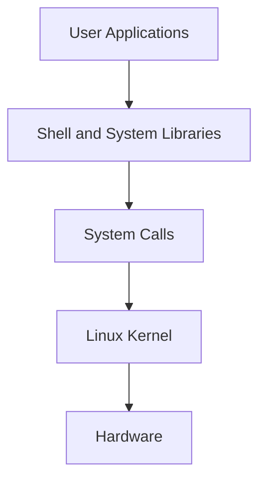
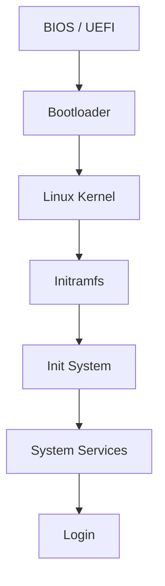

# 03. Архитектура и загрузка Linux

## Цели и предварительные требования

Проследить переход от загрузчика к пользовательскому процессу.

Понадобится ВМ и глава об установке.

## Как это работает

UEFI загружает загрузчик или ядро, initramfs подготавливает доступ к корневой ФС, а PID 1 запускает службы. Пользовательские приложения обращаются к ядру через системные вызовы; драйверы работают с устройствами от имени ядра.

Переход от initramfs к корневой ФС обычно выполняется после обнаружения драйверов, томов и ключей. Сбой на этом этапе оставляет ограниченную аварийную оболочку. Для анализа времени после запуска PID 1 сопоставьте systemd-analyze time и critical-chain: первый инструмент измеряет этапы, второй показывает зависимости с временными отметками.

## Синтаксис и практический пример

```bash
cat /proc/cmdline
```

Виртуальный файл показывает параметры, переданные ядру при загрузке, включая root= при его наличии.

Ожидаемый результат для примера. Вывод представляет одну строку. Фактический идентификатор корня зависит от конфигурации загрузки.

## Справочные примеры

> Команды ниже предназначены для учебной среды. Операции с `sudo`, разделами, сетью, системными службами и учётными записями выполняйте только в одноразовой ВМ с доступом к её консоли.

### Архитектура Linux



#### Основные компоненты

| Компонент | Описание |
|---|---|
| Kernel | Ядро операционной системы |
| Shell | Командный интерпретатор |
| System Libraries | Системные библиотеки |
| System Utilities | Системные утилиты |
| Init System | Управление запуском системы |
| File System | Организация хранения данных |
| User Space | Пространство пользовательских процессов |
| Kernel Space | Пространство ядра |

#### Процесс загрузки Linux



## Применение и диагностика

При задержке до запуска PID 1 проверьте доступность корневого устройства и содержимое initramfs в консоли ВМ.

Не передавайте секреты в параметрах ядра. Для эксперимента сохраните рабочую загрузочную запись.

## Практика и самопроверка

1. Сопоставьте параметры загрузки с findmnt -no SOURCE / и изучите журнал текущей загрузки.
2. Какая часть загрузки отвечает за обнаружение зашифрованного корня?

## Итоги и документация

На практике важно проследить переход от загрузчика к пользовательскому процессу. Обоснуйте вывод наблюдаемыми признаками из учебного примера.

- [Документация по теме](https://docs.kernel.org/)

[Предыдущая глава](02-installation.md) · [Оглавление](../README.md) · [Следующая глава](04-filesystem.md)
