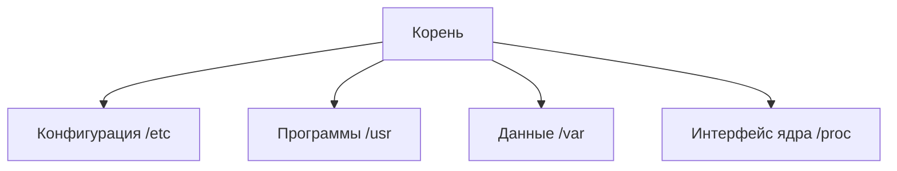

# 04. Файловая система

## Цели и предварительные требования

Отличать каталог от точки монтирования, а путь от inode.

Понадобится Терминал и базовые команды.

## Как это работает

VFS представляет общий интерфейс для разных файловых систем. Точка монтирования связывает дерево имён с корнем другой ФС. /proc и /sys отражают состояние ядра и могут не занимать постоянного места на диске.



Родительский каталог хранит имя и ссылку на inode. У inode есть метаданные и ссылки на блоки, а дескриптор открытого файла остаётся действительным после удаления имени. Если du и df расходятся, проверьте lsof +L1, скрытое монтированием содержимое и снимки файловой системы.

## Синтаксис и практический пример

```bash
findmnt -T /proc -o TARGET,FSTYPE,OPTIONS
```

Опция -T находит ФС заданного пути, -o выбирает колонки.

Ожидаемый результат для примера. TARGET будет /proc, тип — proc. Опции различаются между хостом и контейнером.

## Справочные примеры

> Команды ниже предназначены для учебной среды. Операции с `sudo`, разделами, сетью, системными службами и учётными записями выполняйте только в одноразовой ВМ с доступом к её консоли.

### Файловая система

В Linux используется иерархическая файловая система, начинающаяся с корневого каталога `/`.

```text
/
├── bin
├── boot
├── dev
├── etc
├── home
├── lib
├── media
├── mnt
├── opt
├── proc
├── root
├── run
├── sbin
├── srv
├── sys
├── tmp
├── usr
└── var
```

| Каталог | Назначение |
|---|---|
| `/` | Корневой каталог |
| `/bin` | Основные исполняемые файлы |
| `/boot` | Файлы загрузки системы |
| `/dev` | Файлы устройств |
| `/etc` | Конфигурационные файлы |
| `/home` | Домашние каталоги пользователей |
| `/lib` | Системные библиотеки |
| `/media` | Съёмные носители |
| `/mnt` | Временные точки монтирования |
| `/opt` | Дополнительное ПО |
| `/proc` | Виртуальная информация о процессах и ядре |
| `/root` | Домашний каталог root |
| `/run` | Данные работающей системы |
| `/sbin` | Системные исполняемые файлы |
| `/srv` | Данные системных служб |
| `/sys` | Интерфейс к объектам ядра |
| `/tmp` | Временные файлы |
| `/usr` | Программы и библиотеки |
| `/var` | Изменяемые данные и журналы |

В современных дистрибутивах некоторые каталоги, например `/bin` и `/sbin`, могут быть символическими ссылками на соответствующие каталоги внутри `/usr`.

#### Типы файловых систем

- EXT4
- XFS
- Btrfs
- ZFS
- FAT32
- exFAT
- NTFS
- F2FS
- tmpfs

## Применение и диагностика

Если файлы «исчезли» после монтирования, сопоставьте дерево findmnt с ожидаемым устройством. Смонтированный каталог может скрывать исходное содержимое.

Не делайте непроверенные записи в /proc/sys и /sys. Проверяйте опции ro, nosuid и nodev по требованиям службы.

## Практика и самопроверка

1. Найдите ФС для /, /proc и /tmp. Объясните, почему последние два пути могут иметь разные типы.
2. Могут ли два процесса видеть разные файловые системы по одному пути?

## Итоги и документация

На практике важно отличать каталог от точки монтирования, а путь от inode. Обоснуйте вывод наблюдаемыми признаками из учебного примера.

- [Документация по теме](https://refspecs.linuxfoundation.org/FHS_3.0/fhs/index.html)

[Предыдущая глава](03-linux-architecture.md) · [Оглавление](../README.md) · [Следующая глава](05-terminal.md)
