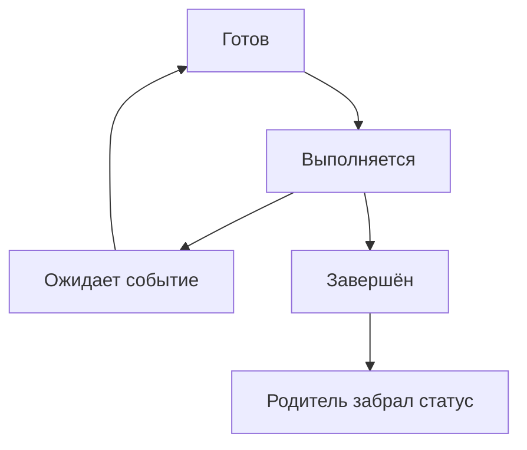

# 10. Управление процессами

## Цели и предварительные требования

Различать состояние процесса, задания оболочки и сигналы.

Понадобится Linux с procps и Bash.

## Как это работает

Процесс содержит адресное пространство и дескрипторы. Планировщик выбирает готовые к исполнению потоки. Родитель забирает статус завершения через wait, до этого завершившийся процесс может сохранять запись zombie.



Команда exec заменяет образ процесса, обычно сохраняя PID. fork создаёт дочерний процесс. Сигнал SIGTERM приложение может обработать для завершения запросов, SIGKILL обработать нельзя. При аварии сначала определите состояние и владельца задачи, затем выбирайте действие.

## Синтаксис и практический пример

```bash
ps -p "$$" -o pid,ppid,stat,comm
```

Опция -p выбирает PID текущей оболочки, -o задаёт колонки.

Ожидаемый результат для примера. Появится строка с PID, родителем, состоянием и именем оболочки.

## Справочные примеры

> Команды ниже предназначены для учебной среды. Операции с `sudo`, разделами, сетью, системными службами и учётными записями выполняйте только в одноразовой ВМ с доступом к её консоли.

### Управление процессами

> **Внимание.** Изменения из этого раздела выполняйте только в одноразовой ВМ со снимком.

Процесс — выполняющийся экземпляр программы.

PID идентифицирует процесс в данном пространстве имён и может повторно использоваться после завершения процесса.

#### Просмотр процессов

```bash
ps
ps aux
ps -ef
pstree
top
htop
```

#### Поиск процессов

```bash
pgrep nginx
pidof nginx
pgrep -a nginx
```

#### Завершение процессов

```bash
kill -TERM 1234
kill -KILL 1234
pkill -TERM nginx
```

Используйте `SIGKILL` только тогда, когда обычное завершение процесса не помогает.

#### Основные сигналы

| Сигнал | Номер | Назначение |
|---|---|---|
| SIGHUP | 1 | Разрыв соединения или перезагрузка конфигурации |
| SIGINT | 2 | Прерывание |
| SIGKILL | 9 | Принудительное завершение |
| SIGTERM | 15 | Запрос корректного завершения |
| SIGSTOP | 19* | Приостановка процесса |

*Номер SIGSTOP зависит от архитектуры. Предпочтительно использовать имена сигналов.

#### Фоновые процессы

```bash
sleep 300 &
jobs
fg %1
bg %1
```

Запуск с сохранением работы после выхода из терминала:

```bash
nohup ./script.sh > output.log 2>&1 &
```

#### Приоритет процессов

```bash
nice -n 10 ./script.sh
renice 5 -p 1234
```

## Применение и диагностика

При D в STAT проверьте операции ввода-вывода, а при Z исследуйте родительский процесс.

Перед отправкой сигнала подтвердите PID, владельца и назначение процесса. Начинайте с SIGTERM.

## Практика и самопроверка

1. Запустите sleep в фоне, определите PID через $!, завершите свою задачу и заберите результат через wait.
2. Когда SIGKILL не приводит к немедленному исчезновению записи процесса?

## Итоги и документация

На практике важно различать состояние процесса, задания оболочки и сигналы. Обоснуйте вывод наблюдаемыми признаками из учебного примера.

- [Документация по теме](https://man7.org/linux/man-pages/man7/signal.7.html)

[Предыдущая глава](09-package-management.md) · [Оглавление](../README.md) · [Следующая глава](11-systemd.md)
