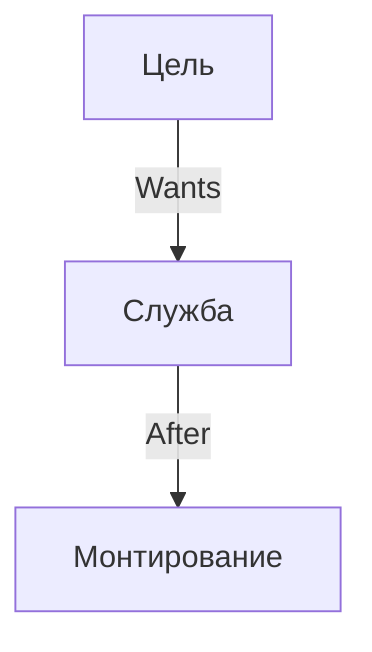

# 11. Службы systemd

## Цели и предварительные требования

Объяснять работу компонентов темы «Службы systemd» и проверять их состояние на практике.

Понадобится Учебная ВМ с systemd.

## Как это работает

After задаёт порядок, Wants и Requires инициируют включение зависимости. Для готовности приложения нужен собственный протокол, например Type=notify.



Alpine Linux обычно использует OpenRC. Состояние службы проверяют через `rc-service имя status`, а списки уровней запуска через `rc-status`. Gentoo поддерживает варианты с OpenRC и systemd.

Юниты привязывают процесс к жизненному циклу и cgroup. Тип simple считает службу запущенной раньше, чем приложение подтвердит готовность. При зависимости от доступности используйте протокол уведомления, сокетную активацию или повторы клиента. Перед изменениями проверьте drop-in через systemctl cat и журнал через journalctl -u.

## Синтаксис и практический пример

```bash
systemctl show -p After -p Wants -p Requires multi-user.target
```

Ожидаемый результат для примера. В каждой строке выводится свойство и список юнитов.

## Справочные примеры

> Команды ниже предназначены для учебной среды. Операции с `sudo`, разделами, сетью, системными службами и учётными записями выполняйте только в одноразовой ВМ с доступом к её консоли.

### Системные службы

> **Внимание.** Изменения из этого раздела выполняйте только в одноразовой ВМ со снимком.

В большинстве современных дистрибутивов используется systemd.

#### Управление службами

```bash
sudo systemctl start nginx
sudo systemctl stop nginx
sudo systemctl restart nginx
sudo systemctl reload nginx
systemctl status nginx
```

#### Автоматический запуск

```bash
sudo systemctl enable nginx
sudo systemctl disable nginx
sudo systemctl enable --now nginx
```

#### Просмотр служб

```bash
systemctl list-units --type=service
systemctl list-unit-files --type=service
systemctl --failed
```

#### Создание собственной службы

Файл:

```text
/etc/systemd/system/myapp.service
```

Содержимое:

```ini
[Unit]
Description=My Application
After=network.target

[Service]
Type=simple
User=developer
WorkingDirectory=/opt/myapp
ExecStart=/usr/bin/node /opt/myapp/index.js
Restart=on-failure
RestartSec=5
NoNewPrivileges=true
PrivateTmp=true

[Install]
WantedBy=multi-user.target
```

Для запуска необходимо предварительно создать пользователя `developer`, установить Node.js и разместить приложение в `/opt/myapp`.

```bash
sudo systemctl daemon-reload
sudo systemctl enable --now myapp
systemctl status myapp
```

Просмотр журналов:

```bash
journalctl -u myapp -f
```

## Применение и диагностика

При циклической зависимости изучите журнал загрузки и systemd-analyze verify. Для пользовательских юнитов используйте systemctl --user.

## Практика и самопроверка

1. Сравните systemctl cat и systemctl show для одного юнита.
2. Почему After не запускает зависимую службу?

## Итоги и документация

На практике важно объяснять работу компонентов темы «Службы systemd» и проверять их состояние на практике. Обоснуйте вывод наблюдаемыми признаками из учебного примера.

- [Документация по теме](https://www.freedesktop.org/software/systemd/man/latest/systemd.unit.html)

[Предыдущая глава](10-process-management.md) · [Оглавление](../README.md) · [Следующая глава](12-networking.md)
