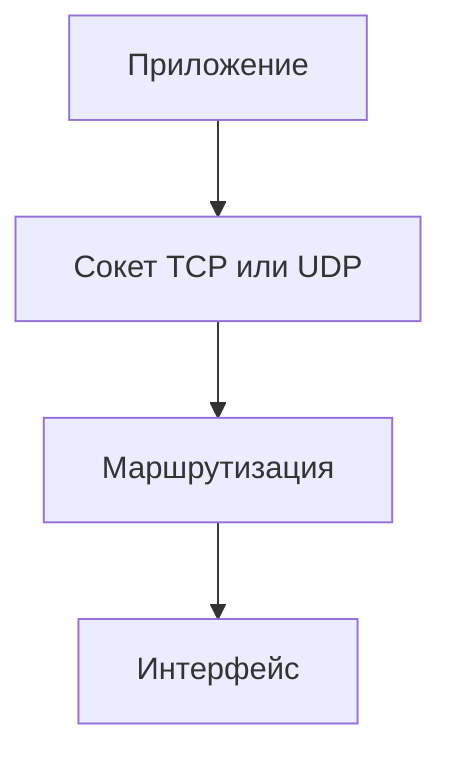

# 12. Сетевая диагностика

## Цели и предварительные требования

Объяснять работу компонентов темы «Сетевая диагностика» и проверять их состояние на практике.

Понадобится Учебная ВМ Linux и [предыдущая глава](11-systemd.md).

## Как это работает

route get вычисляет маршрут для конкретного назначения, учитывая policy routing. Разрешение DNS и доставка HTTP проверяются отдельными шагами.



Маршрутизация выбирает выход и следующий узел, DNS разрешает имя, TCP устанавливает соединение, TLS подтверждает имя сервера и защищает транспорт. Локализуйте сбой по слоям. Для HTTPS при проверке известного адреса сохраняйте имя в URI через curl --resolve, чтобы SNI и проверка имени имели смысл.

## Синтаксис и практический пример

```bash
ip route get 192.0.2.10
```

Ожидаемый результат для примера. При наличии маршрута видны dev и src; при его отсутствии появляется ошибка маршрутизации.

## Справочные примеры

> Команды ниже предназначены для учебной среды. Операции с `sudo`, разделами, сетью, системными службами и учётными записями выполняйте только в одноразовой ВМ с доступом к её консоли.

### Сетевые технологии

#### Основные сетевые понятия

- IP Address
- MAC Address
- Subnet Mask
- Gateway
- DNS
- DHCP
- TCP
- UDP
- HTTP
- HTTPS
- SSH
- NAT
- Firewall

#### Информация о сети

```bash
ip addr
ip link
ip route
hostname -I
```

#### Проверка соединения

```bash
ping -c 4 google.com
ping -c 4 8.8.8.8
```

#### DNS

```bash
dig example.com
nslookup example.com
host example.com
```

#### Просмотр портов

```bash
ss -tuln
sudo ss -tulpn
ss -tan
```

#### HTTP-запросы

```bash
curl https://example.com
curl -I https://example.com
curl -L https://example.com
```

POST-запрос:

```bash
curl -X POST https://api.example.com/users \
    -H "Content-Type: application/json" \
    -d '{"name":"Developer"}'
```

#### Загрузка файлов

```bash
wget https://example.com/file.zip
curl -LO https://example.com/file.zip
```

#### Диагностика маршрутов

```bash
traceroute example.com
tracepath example.com
mtr example.com
```

#### Основные порты

| Порт | Протокол |
|---|---|
| 20/21 | FTP |
| 22 | SSH |
| 25 | SMTP |
| 53 | DNS |
| 67/68 | DHCP |
| 80 | HTTP |
| 110 | POP3 |
| 123 | NTP |
| 143 | IMAP |
| 443 | HTTPS |
| 445 | SMB |
| 3306 | MySQL |
| 5432 | PostgreSQL |
| 6379 | Redis |
| 27017 | MongoDB |

## Применение и диагностика

Сравните маршрут и список слушающих портов. Проверяйте TCP и UDP отдельно; ICMP может фильтроваться.

## Практика и самопроверка

1. Сравните маршрут к 127.0.0.1 и к тестовому адресу.
2. Почему успешный ping не подтверждает работу TLS?

## Итоги и документация

На практике важно объяснять работу компонентов темы «Сетевая диагностика» и проверять их состояние на практике. Обоснуйте вывод наблюдаемыми признаками из учебного примера.

- [Документация по теме](https://man7.org/linux/man-pages/man8/ip.8.html)

[Предыдущая глава](11-systemd.md) · [Оглавление](../README.md) · [Следующая глава](13-ssh.md)
