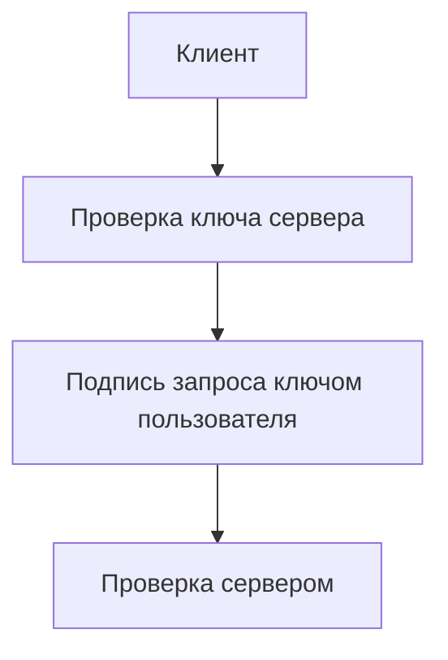

# 13. Удалённый доступ по SSH

## Цели и предварительные требования

Объяснять работу компонентов темы «Удалённый доступ по SSH» и проверять их состояние на практике.

Понадобится OpenSSH client и учебный профиль.

## Как это работает

Флаг -G печатает итоговые параметры клиента без подключения. Ключ хоста подтверждает сервер, ключ пользователя используется для подписи запроса аутентификации.



На Debian и Ubuntu традиционное имя службы — `ssh.service`, на Fedora и RHEL — `sshd.service`. Проверьте также `ssh.socket`: при активации сокетом параметры слушателя могут задаваться в отдельном юните.

У sshd первое полученное значение для многих параметров определяет результат, а Match выбирает настройки по контексту. Положение Include важно для drop-in. У клиента IdentitiesOnly ограничивает варианты ключей, а BatchMode подходит для проверки автоматизации без запроса пароля.

## Синтаксис и практический пример

```bash
ssh -G -p 2222 operator@host.example
```

Ожидаемый результат для примера. В выводе будут user operator и port 2222.

## Справочные примеры

> Команды ниже предназначены для учебной среды. Операции с `sudo`, разделами, сетью, системными службами и учётными записями выполняйте только в одноразовой ВМ с доступом к её консоли.

### SSH

> **Внимание.** Изменения из этого раздела выполняйте только в одноразовой ВМ со снимком.

SSH — защищённый протокол удалённого управления системами.

#### Установка SSH-сервера

Ubuntu / Debian:

```bash
sudo apt install openssh-server
sudo systemctl enable --now ssh
```

#### Подключение

```bash
ssh user@192.168.1.100
```

Подключение через другой порт:

```bash
ssh -p 2222 user@192.168.1.100
```

#### Создание SSH-ключа

```bash
ssh-keygen -t ed25519 -C "developer@example.com"
```

Рекомендуется защищать приватный ключ парольной фразой.

#### Копирование публичного ключа

```bash
ssh-copy-id user@192.168.1.100
```

#### Передача файлов

```bash
scp file.txt user@192.168.1.100:/home/user/
```

```bash
scp -r project user@192.168.1.100:/home/user/
```

#### SFTP

```bash
sftp user@192.168.1.100
```

#### SSH Config

Файл:

```text
~/.ssh/config
```

```sshconfig
Host production
    HostName 192.168.1.100
    User developer
    Port 22
    IdentityFile ~/.ssh/id_ed25519
```

Подключение:

```bash
ssh production
```

#### Безопасная настройка SSH

Файл конфигурации:

```text
/etc/ssh/sshd_config
```

Рекомендуемые параметры:

```text
PermitRootLogin no
PubkeyAuthentication yes
PasswordAuthentication no
MaxAuthTries 3
```

Перед отключением парольной аутентификации необходимо проверить вход по SSH-ключу в отдельном сеансе.

Проверка конфигурации:

```bash
sudo sshd -t
```

Применение настроек:

```bash
sudo systemctl reload ssh
```

## Применение и диагностика

При отказе проверьте права ~/.ssh и эффективную серверную конфигурацию с sshd -T. Сохраните действующий сеанс при изменении политики.

## Практика и самопроверка

1. Добавьте IdentityFile в учебный профиль и сравните ssh -G до и после.
2. Как проверить подлинность ключа при первом подключении?

## Итоги и документация

На практике важно объяснять работу компонентов темы «Удалённый доступ по SSH» и проверять их состояние на практике. Обоснуйте вывод наблюдаемыми признаками из учебного примера.

- [Документация по теме](https://www.openssh.com/manual.html)

[Предыдущая глава](12-networking.md) · [Оглавление](../README.md) · [Следующая глава](14-disk-management.md)
