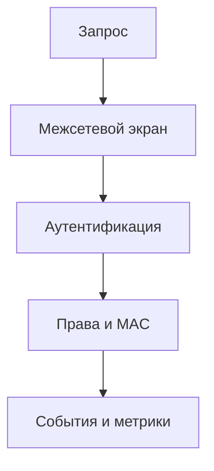

# 17. Защита Linux

## Цели и предварительные требования

Объяснять работу компонентов темы «Защита Linux» и проверять их состояние на практике.

Понадобится Учебная ВМ Linux и [предыдущая глава](16-automation.md).

## Как это работает

Флаги выбирают TCP-слушатели, убирают заголовок и отключают разрешение имён. Модель угроз связывает активы, субъектов и возможные пути доступа.



Проверяйте защиту от входа скомпрометированным ключом и изменение конфигурации отдельно. Межсетевой экран уменьшает число доступных служб, минимальные права ограничивают последствия отказа, мониторинг помогает заметить сбой. Включите запасной консольный доступ до изменения SSH либо firewall.

## Синтаксис и практический пример

```bash
ss -H -ltn
```

Ожидаемый результат для примера. В выводе только слушающие сокеты TCP. Набор портов зависит от служб.

## Справочные примеры

> Команды ниже предназначены для учебной среды. Операции с `sudo`, разделами, сетью, системными службами и учётными записями выполняйте только в одноразовой ВМ с доступом к её консоли.

### Информационная безопасность

> **Внимание.** Изменения из этого раздела выполняйте только в одноразовой ВМ со снимком.

Безопасность Linux строится на принципе минимальных привилегий, регулярных обновлениях, контроле доступа и мониторинге системы.

#### Основные правила

- Регулярно обновляйте систему.
- Не используйте root для повседневной работы.
- Используйте SSH-ключи.
- Настройте межсетевой экран.
- Отключайте ненужные службы.
- Проверяйте системные журналы.
- Создавайте резервные копии.
- Используйте надёжные пароли.
- Устанавливайте ПО из доверенных источников.
- Не выполняйте неизвестные скрипты без проверки.
- Храните секреты вне исходного кода.

#### UFW

Установка:

```bash
sudo apt install ufw
```

Настройка:

```bash
sudo ufw default deny incoming
sudo ufw default allow outgoing
sudo ufw allow OpenSSH
sudo ufw allow 80/tcp
sudo ufw allow 443/tcp
sudo ufw enable
```

Перед включением UFW на удалённом сервере убедитесь, что фактический порт SSH разрешён.

```bash
sudo ufw status verbose
sudo ufw status numbered
```

#### Fail2Ban

```bash
sudo apt install fail2ban
sudo systemctl enable --now fail2ban
sudo fail2ban-client status
```

#### Проверка открытых портов

```bash
sudo ss -tulpn
```

#### Проверка целостности файлов

```bash
sha256sum file.iso
sha512sum file.iso
```

Проверка по доверенному списку контрольных сумм:

```bash
sha256sum -c SHA256SUMS
```

#### SELinux

```bash
getenforce
sestatus
```

#### AppArmor

```bash
sudo aa-status
```

Не отключайте SELinux или AppArmor только ради устранения ошибки приложения. Сначала определите причину блокировки.

#### Аудит безопасности

```bash
sudo lynis audit system
```

Для аудита необходимо предварительно установить Lynis.

#### Дополнительные инструменты

| Инструмент | Назначение |
|---|---|
| Nmap | Аудит собственной сетевой инфраструктуры |
| Wireshark | Анализ сетевого трафика |
| Tcpdump | Захват сетевых пакетов |
| Lynis | Аудит безопасности системы |
| Auditd | Системный аудит |
| ClamAV | Проверка файлов |
| Fail2Ban | Защита от повторяющихся попыток входа |
| OpenSSL | Криптографические операции |
| GnuPG | Шифрование и цифровые подписи |
| AIDE | Контроль целостности файлов |

Используйте инструменты тестирования безопасности только в собственных системах или при наличии разрешения владельца.

## Применение и диагностика

Сверяйте привязку 0.0.0.0 с требованиями доступа. Начинайте изменение firewall с консоли ВМ и предварительного подтверждения правила SSH.

## Практика и самопроверка

1. Разделите учебные TCP-слушатели на локальные и сетевые по адресу привязки.
2. Почему открытый TCP-сокет ещё не доказывает доступность извне?

## Итоги и документация

На практике важно объяснять работу компонентов темы «Защита Linux» и проверять их состояние на практике. Обоснуйте вывод наблюдаемыми признаками из учебного примера.

- [Документация по теме](https://documentation.ubuntu.com/server/how-to/security/)

[Предыдущая глава](16-automation.md) · [Оглавление](../README.md) · [Следующая глава](18-monitoring.md)
