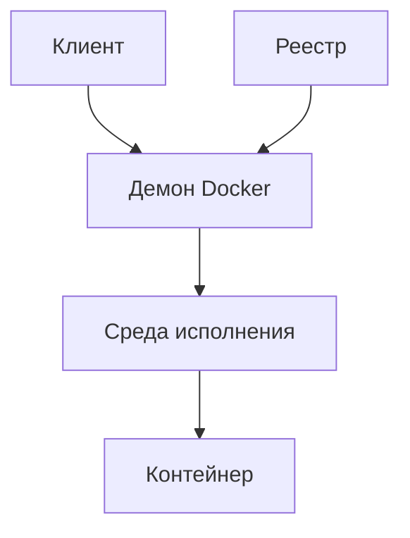

# 20. Контейнеры Docker

## Цели и предварительные требования

Объяснять работу компонентов темы «Контейнеры Docker» и проверять их состояние на практике.

Понадобится Локальный Docker Engine и CLI.

## Как это работает

Контекст хранит настройки подключения к демону. Образ состоит из слоёв, контейнер получает изменяемый слой, а volume живёт отдельно от него.



Контейнер зависит от ядра хоста. Для локального стенда публикуйте порт на 127.0.0.1 и ограничивайте UID, capabilities и запись. Именованные тома переживают удаление контейнера, а bind mount даёт доступ к файлам хоста. Привязывайте релиз к digest, если требуется повторяемость.

## Синтаксис и практический пример

```bash
docker context show
```

Ожидаемый результат для примера. Типовой локальный контекст может называться default. Имя определяется конфигурацией клиента.

## Справочные примеры

> Команды ниже предназначены для учебной среды. Операции с `sudo`, разделами, сетью, системными службами и учётными записями выполняйте только в одноразовой ВМ с доступом к её консоли.

### Docker

> **Внимание.** Изменения из этого раздела выполняйте только в одноразовой ВМ со снимком.

Docker — платформа для создания, доставки и запуска приложений в контейнерах.

#### Основные понятия

- Image
- Container
- Dockerfile
- Volume
- Network
- Registry
- Docker Compose

#### Проверка установки

```bash
docker --version
docker compose version
```

Устанавливайте Docker по официальной документации для вашего дистрибутива.

#### Основные команды

```bash
docker pull nginx
docker images
docker ps
docker ps -a
```

#### Запуск контейнера

```bash
docker run -d \
    --name web-server \
    -p 127.0.0.1:8080:80 \
    nginx
```

#### Управление контейнерами

```bash
docker stop web-server
docker start web-server
docker restart web-server
docker logs web-server
docker inspect web-server
docker exec -it web-server sh
```

#### Удаление контейнера

```bash
docker stop web-server
docker rm web-server
```

#### Dockerfile

```dockerfile
FROM node:24-alpine

WORKDIR /app

COPY package*.json ./

RUN npm ci --omit=dev

COPY --chown=node:node . .

USER node

EXPOSE 3000

CMD ["node", "index.js"]
```

Для этого примера необходимы `package.json`, `package-lock.json` и `index.js`.

#### .dockerignore

```text
node_modules
.git
.env
.env.*
npm-debug.log
```

#### Сборка образа

```bash
docker build -t myapp .
```

#### Запуск приложения

```bash
docker run -d \
    --name myapp \
    -p 127.0.0.1:3000:3000 \
    myapp
```

#### Docker Compose

```yaml
services:
  app:
    build: .
    ports:
      - "127.0.0.1:3000:3000"
    environment:
      NODE_ENV: production
    restart: unless-stopped

  redis:
    image: redis:7-alpine
    volumes:
      - redis_data:/data
    restart: unless-stopped

volumes:
  redis_data:
```

```bash
docker compose up -d
docker compose ps
docker compose logs -f
docker compose down
```

#### Безопасность Docker

- Не запускайте приложения от root без необходимости.
- Используйте минимальные образы.
- Не храните секреты внутри Dockerfile.
- Регулярно обновляйте образы.
- Ограничивайте доступ к Docker Socket.
- Не публикуйте внутренние порты без необходимости.
- Учитывайте, что членство в группе `docker` обычно даёт привилегии уровня root.

## Применение и диагностика

Перед изменением контейнеров проверьте контекст, привязку портов и расположение томов. Доступ к сокету демона строго ограничивайте.

## Практика и самопроверка

1. Сравните docker context show и docker info в учебном окружении.
2. Что останется после удаления контейнера с именованным томом?

## Итоги и документация

На практике важно объяснять работу компонентов темы «Контейнеры Docker» и проверять их состояние на практике. Обоснуйте вывод наблюдаемыми признаками из учебного примера.

- [Документация по теме](https://docs.docker.com/)

[Предыдущая глава](19-nginx.md) · [Оглавление](../README.md) · [Следующая глава](21-git.md)
