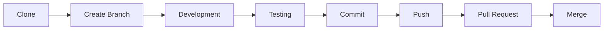

# 21. Git и совместная работа

## Цели и предварительные требования

Объяснять работу компонентов темы «Git и совместная работа» и проверять их состояние на практике.

Понадобится Git и рабочая копия репозитория.

## Как это работает

Короткий формат показывает состояние индекса и рабочего дерева. Коммит хранит снимок и родительские связи; ветка — изменяемая ссылка на коммит.

В staging можно подготовить часть изменений через git add -p. При общей истории git revert добавляет новый коммит для отмены выбранного изменения. Перед отправкой проверьте diff индекса и remote; приватный ключ или токен, попавшие в историю, нужно отозвать.

## Синтаксис и практический пример

```bash
git status --short --branch
```

Ожидаемый результат для примера. Чистая ветка main показывает строку, начинающуюся с ## main.

## Справочные примеры

> Команды ниже предназначены для учебной среды. Операции с `sudo`, разделами, сетью, системными службами и учётными записями выполняйте только в одноразовой ВМ с доступом к её консоли.

### Git и GitHub

Git — распределённая система контроля версий.

#### Установка

```bash
sudo apt install git
```

#### Настройка

```bash
git config --global user.name "Developer"
git config --global user.email "developer@example.com"
git config --global init.defaultBranch main
```

#### Создание репозитория

```bash
git init
git status
git add .
git commit -m "Initial commit"
```

#### Клонирование

```bash
git clone https://github.com/username/repository.git
```

#### Основные команды

```bash
git status
git diff
git diff --staged
git log --oneline
git add .
git commit -m "Update project"
git pull
git push
```

#### Работа с ветками

```bash
git branch
git switch -c feature
git switch main
git merge feature
git branch -d feature
```

#### Подключение GitHub

```bash
git remote add origin \
    git@github.com:username/repository.git

git push -u origin main
```

#### .gitignore

```gitignore
node_modules/
.env
.env.*
!.env.example
dist/
build/
*.log
__pycache__/
.venv/
```

#### Рекомендуемый рабочий процесс



## Применение и диагностика

Перед коммитом просмотрите git diff --cached; проверяйте назначение remote перед отправкой. Случайно опубликованный секрет отзовите.

## Практика и самопроверка

1. Измените файл в учебной копии, добавьте его в индекс и сравните два вида diff.
2. Чем удалённая ссылка origin/main отличается от локальной main?

## Итоги и документация

На практике важно объяснять работу компонентов темы «Git и совместная работа» и проверять их состояние на практике. Обоснуйте вывод наблюдаемыми признаками из учебного примера.

- [Документация по теме](https://git-scm.com/docs)

[Предыдущая глава](20-docker.md) · [Оглавление](../README.md) · [Следующая глава](22-backup.md)
