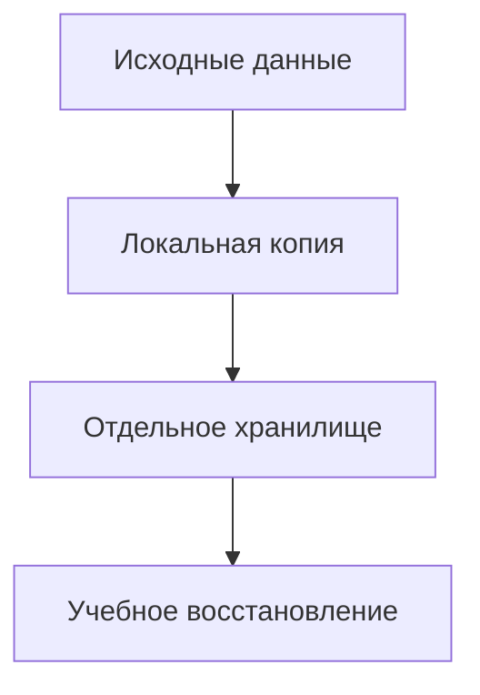

# 22. Резервное копирование и восстановление

## Цели и предварительные требования

Объяснять работу компонентов темы «Резервное копирование и восстановление» и проверять их состояние на практике.

Понадобится GNU tar и подготовленный учебный архив backup.tar.gz.

## Как это работает

Флаг -t перечисляет записи, -z включает gzip, -f задаёт архив. RPO описывает допустимую потерю данных во времени, RTO — допустимое время восстановления.



Логическая копия PostgreSQL предоставляет согласованный снимок базы на момент начала выгрузки, но роли и tablespaces планируют отдельно. Для восстановления к моменту времени необходима подходящая физическая копия и последовательность WAL. Зафиксируйте время проверки восстановления и сравните его с RTO.

## Синтаксис и практический пример

```bash
tar -tzf backup.tar.gz
```

Ожидаемый результат для примера. Ожидается список файлов архива, например notes.txt. Повреждённый поток завершится ошибкой.

## Справочные примеры

> Команды ниже предназначены для учебной среды. Операции с `sudo`, разделами, сетью, системными службами и учётными записями выполняйте только в одноразовой ВМ с доступом к её консоли.

### Резервное копирование

#### Rsync

```bash
rsync -avh /home/user/documents/ /mnt/backup/documents/
```

Удалённое резервное копирование:

```bash
rsync -avh -e ssh \
    /home/user/documents/ \
    user@backup-server:/backups/documents/
```

Предварительная проверка:

```bash
rsync -avhn source/ destination/
```

#### Автоматический Bash-скрипт

```bash
#!/usr/bin/env bash

set -euo pipefail
umask 077

SOURCE="$HOME/documents"
DESTINATION="$HOME/backups"
DATE=$(date +%Y-%m-%d_%H-%M-%S)

mkdir -p "$DESTINATION"

tar -czf "$DESTINATION/backup-$DATE.tar.gz" \
    -C "$(dirname "$SOURCE")" \
    "$(basename "$SOURCE")"

echo "Backup completed successfully."
```

#### Резервное копирование PostgreSQL

```bash
pg_dump -Fc -U postgres mydatabase > database.dump
```

Восстановление в предварительно созданную базу:

```bash
pg_restore -U postgres \
    -d restored_database database.dump
```

#### Правило 3-2-1

- 3 копии данных.
- 2 разных типа носителей.
- 1 копия вне основной инфраструктуры.

Резервное копирование считается надёжным только после успешной проверки восстановления.

## Применение и диагностика

Проверяйте архив чтением и тестовым восстановлением в пустой каталог. Защищайте ключ шифрования отдельно от копии.

## Практика и самопроверка

1. Создайте архив двух файлов, восстановите их и сравните sha256sum.
2. Чем проверка списка записей отличается от проверки возможности восстановления?

## Итоги и документация

На практике важно объяснять работу компонентов темы «Резервное копирование и восстановление» и проверять их состояние на практике. Обоснуйте вывод наблюдаемыми признаками из учебного примера.

- [Документация по теме](https://www.postgresql.org/docs/current/app-pgdump.html)

[Предыдущая глава](21-git.md) · [Оглавление](../README.md) · [Следующая глава](23-linux-kernel.md)
