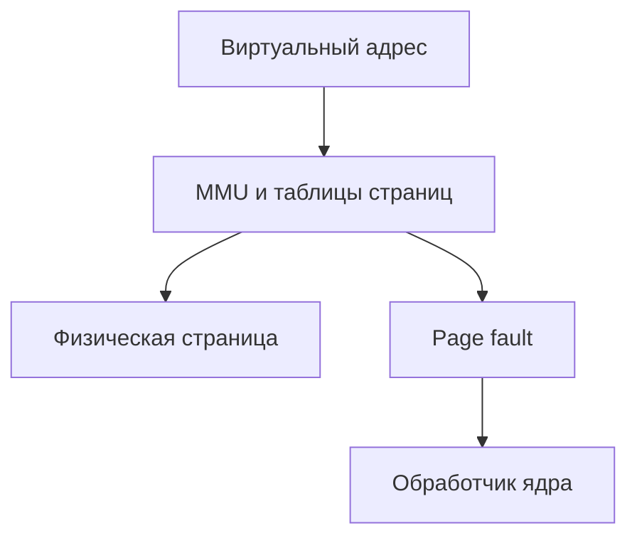

# 23. Ядро Linux

## Цели и предварительные требования

Объяснять работу компонентов темы «Ядро Linux» и проверять их состояние на практике.

Понадобится Linux с доступом к /proc.

## Как это работает

Опция -r показывает релиз текущего ядра. Виртуальная память адресуется через таблицы страниц, а сбои обращения обрабатывает ядро. Модули расширяют ядро во время работы.



Ядро планирует потоки с учётом класса и ограничений cgroup. MMU переводит виртуальные адреса, а при недоступной странице ядро отдельно решает, нужен ли I/O или достаточно обновить отображение. Сравнение major/minor faults помогает выбрать дальнейшую проверку.

## Синтаксис и практический пример

```bash
uname -r
```

Ожидаемый результат для примера. Будет одна строка с версией и, часто, суффиксом сборки.

## Справочные примеры

> Команды ниже предназначены для учебной среды. Операции с `sudo`, разделами, сетью, системными службами и учётными записями выполняйте только в одноразовой ВМ с доступом к её консоли.

### Ядро Linux

> **Внимание.** Изменения из этого раздела выполняйте только в одноразовой ВМ со снимком.

Ядро управляет аппаратными ресурсами, памятью, процессами, драйверами и системными вызовами.

#### Версия ядра

```bash
uname -r
uname -a
```

#### Модули ядра

```bash
lsmod
modinfo overlay
```

Загрузка модуля:

```bash
sudo modprobe overlay
```

Удаление неиспользуемого модуля:

```bash
sudo modprobe -r overlay
```

#### Сообщения ядра

```bash
sudo dmesg
sudo dmesg -T
sudo dmesg -w
```

#### Параметры ядра

```bash
sysctl -a
sysctl vm.swappiness
```

Конфигурационные файлы:

```text
/etc/sysctl.conf
/etc/sysctl.d/
```

#### Виртуальные файловые системы

```bash
cat /proc/cpuinfo
cat /proc/meminfo
cat /proc/uptime
cat /proc/loadavg
cat /proc/version
```

#### Дополнительные темы

- System Calls
- Kernel Modules
- Memory Management
- Process Scheduling
- Virtual Memory
- Namespaces
- Control Groups
- Device Drivers
- eBPF
- Linux Capabilities
- Seccomp

## Применение и диагностика

После обновления проверьте, что загружено нужное ядро. Сохраняйте рабочую запись загрузчика перед испытаниями модулей.

## Практика и самопроверка

1. Сравните uname -r и содержимое /lib/modules в ВМ.
2. Что может вызвать page fault у корректной программы?

## Итоги и документация

На практике важно объяснять работу компонентов темы «Ядро Linux» и проверять их состояние на практике. Обоснуйте вывод наблюдаемыми признаками из учебного примера.

- [Документация по теме](https://docs.kernel.org/)

[Предыдущая глава](22-backup.md) · [Оглавление](../README.md) · [Следующая глава](24-troubleshooting.md)
