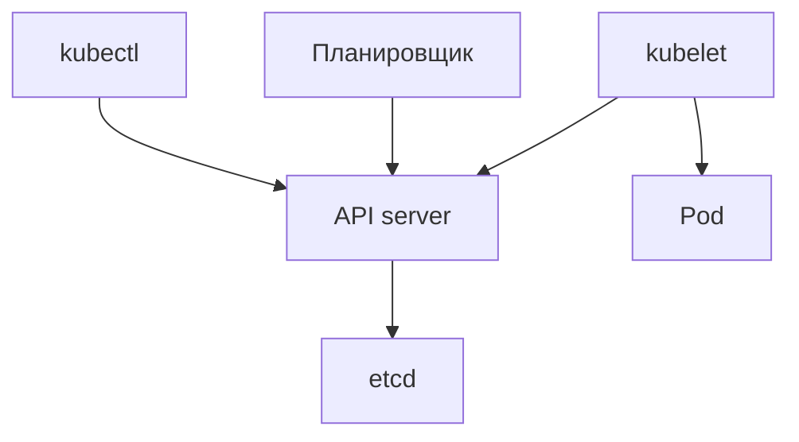

# 28. Оркестрация Kubernetes

## Цели и предварительные требования

Объяснять работу компонентов темы «Оркестрация Kubernetes» и проверять их состояние на практике.

Понадобится Локальный кластер Kubernetes и kubectl.

## Как это работает

Контроллеры сближают фактическое и желаемое состояния. Планировщик назначает Pod узлу, kubelet запускает контейнеры. Service выбирает Pod по меткам, готовность влияет на endpoints.



API server проверяет полномочия и сохраняет объекты через etcd. Планировщик учитывает requests при размещении, kubelet контролирует локальный запуск, контроллеры пересоздают недостающие объекты. При сбое идите от Deployment к конкретному Pod и событиям, затем к Service и EndpointSlice.

## Синтаксис и практический пример

```bash
kubectl get pods -o wide
```

Ожидаемый результат для примера. В учебном namespace видны NAME, READY, STATUS и NODE либо сообщение об отсутствии объектов.

## Применение и диагностика

Сверяйте контекст перед командами. При Pending изучите Events; при неготовности проверьте readiness и EndpointSlice.

### Что проверять в рабочей среде

| Команда или этап | Что даёт проверка |
| --- | --- |
| `kubectl -n lab describe pod ИМЯ` | События планирования, получения образа, проверки готовности и подключения томов объясняют, на каком шаге остановился Pod. |
| `kubectl -n lab logs ИМЯ --previous` | Читает вывод предыдущего контейнера при рестарте. Для Pod с несколькими контейнерами выберите `-c`. |
| `kubectl -n lab get endpointslices -l kubernetes.io/service-name=web` | Сверяет список конечных точек с ожидаемыми репликами. В manifest проверьте selector и соответствие именованных портов. |

## Практика и самопроверка

1. Найдите Pod, его узел и набор меток в локальном кластере.
2. Как readiness влияет на маршрутизацию и чем отличается от liveness?

## Итоги и документация

На практике важно объяснять работу компонентов темы «Оркестрация Kubernetes» и проверять их состояние на практике. Обоснуйте вывод наблюдаемыми признаками из учебного примера.

- [Документация по теме](https://kubernetes.io/docs/concepts/architecture/)

[Предыдущая глава](27-virtualization.md) · [Оглавление](../README.md) · [Следующая глава](29-ansible.md)
