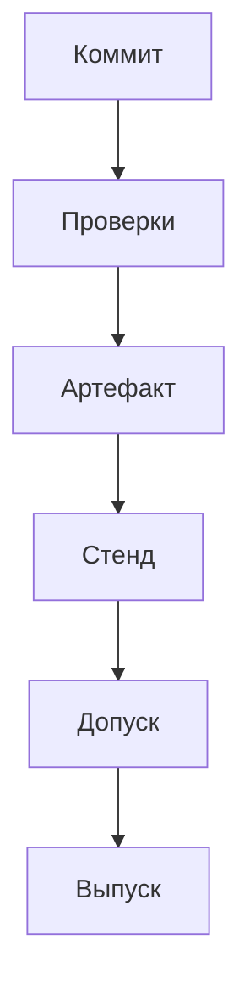

# 31. Непрерывная интеграция и доставка

## Цели и предварительные требования

Объяснять работу компонентов темы «Непрерывная интеграция и доставка» и проверять их состояние на практике.

Понадобится Git и рабочая копия репозитория.

## Как это работает

Опция --check ищет конфликтные маркеры и ошибки пробелов в изменениях. CI проверяет коммит в чистой среде, доставка передаёт идентифицируемый артефакт на следующий этап.



Для pull_request запустите отдельную проверку с токеном чтения. Этап доставки должен брать digest из успешной сборки, проверять разрешения на среду и иметь сценарий возврата. Изменение схемы базы требует совместимости старого и нового приложения на переходном шаге.

## Синтаксис и практический пример

```bash
git diff --check HEAD
```

Ожидаемый результат для примера. При отсутствии проблем вывод пуст и возвращается 0.

## Применение и диагностика

При несовпадении локальных результатов сверяйте версии инструментов и окружение. Для pull_request ограничивайте токен чтением.

### Что проверять в рабочей среде

| Команда или этап | Что даёт проверка |
| --- | --- |
| Проверка изменений | Запускается на PR с полномочиями чтения. Проверяет код, документацию и артефакт только в изолированном раннере. |
| Публикация | Использует зафиксированную версию артефакта и ограниченный контекст среды. Учётные данные выдаются только шагу, которому они нужны. |
| Наблюдение и откат | Сравнивает HTTP-ошибки и задержку до и после выпуска. Возврат приложения требует проверки совместимости с уже обновлёнными данными. |

## Практика и самопроверка

1. Добавьте в учебный файл лишний пробел, воспроизведите и устраните ошибку.
2. Зачем развёртывать один и тот же артефакт в тестовой и рабочей средах?

## Итоги и документация

На практике важно объяснять работу компонентов темы «Непрерывная интеграция и доставка» и проверять их состояние на практике. Обоснуйте вывод наблюдаемыми признаками из учебного примера.

- [Документация по теме](https://docs.github.com/en/actions/reference/workflows-and-actions/workflow-syntax)

[Предыдущая глава](30-terraform.md) · [Оглавление](../README.md) · [Следующая глава](32-performance-tuning.md)
