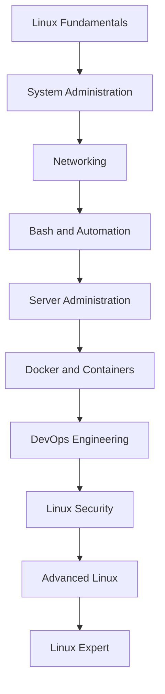

# План обучения и самостоятельные задания

## Этап 1. Linux Fundamentals

Продолжительность: 2–3 недели.

- Терминал
- Файловая система
- Основные команды
- Пользователи
- Права доступа
- Пакетные менеджеры

## Этап 2. System Administration

Продолжительность: 3–4 недели.

- Процессы
- Systemd
- SSH
- Сетевые технологии
- Управление дисками
- Системные журналы
- Мониторинг

## Этап 3. Automation

Продолжительность: 2–3 недели.

- Bash Scripting
- Cron
- Systemd Timers
- Git
- Python Automation
- Ansible

## Этап 4. Server Administration

Продолжительность: 3–4 недели.

- Nginx
- Apache
- PostgreSQL
- Redis
- DNS
- SSL/TLS
- Reverse Proxy
- Backup and Recovery

## Этап 5. DevOps

Продолжительность: 1–2 месяца.

- Docker
- Docker Compose
- Kubernetes
- CI/CD
- GitHub Actions
- Terraform
- Prometheus
- Grafana
- Cloud Computing

## Этап 6. Linux Security

Продолжительность: 1–2 месяца.

- System Hardening
- Firewall
- SSH Security
- Access Control
- SELinux
- AppArmor
- Security Auditing
- Network Security
- Incident Response

## Этап 7. Advanced Linux

Продолжительность: от 2 месяцев.

- Linux Kernel
- System Programming
- Memory Management
- Process Scheduling
- Kernel Modules
- Namespaces
- Cgroups
- eBPF
- Performance Engineering

Сроки являются ориентировочными и зависят от опыта и количества практических занятий.

Повторяйте задачи на одноразовых ВМ и сохраняйте короткие конспекты: что произошло, какие данные это подтвердили, какие действия изменили результат. После ручной проверки переносите повторяющиеся шаги в скрипт. Для сложной диагностики сопоставляйте официальное руководство с исходным кодом той версии, которая работает на стенде.

Рекомендуется выполнять задания в виртуальной машине или отдельной тестовой среде.

## Beginner

- [ ] Установить Ubuntu.
- [ ] Научиться пользоваться терминалом.
- [ ] Создать структуру каталогов проекта.
- [ ] Научиться копировать и перемещать файлы.
- [ ] Изучить права доступа.
- [ ] Создать пользователя и группу.
- [ ] Установить программы через APT.
- [ ] Написать первый Bash-скрипт.
- [ ] Создать и распаковать архив.
- [ ] Изучить основные команды Git.

## Intermediate

- [ ] Настроить SSH-сервер.
- [ ] Настроить вход по SSH-ключу.
- [ ] Установить и настроить Nginx.
- [ ] Развернуть статический веб-сайт.
- [ ] Настроить UFW.
- [ ] Создать systemd-службу.
- [ ] Настроить Cron.
- [ ] Автоматизировать резервное копирование.
- [ ] Научиться анализировать системные журналы.
- [ ] Развернуть PostgreSQL.

## Advanced

- [ ] Развернуть приложение через Docker.
- [ ] Настроить Docker Compose.
- [ ] Настроить Reverse Proxy.
- [ ] Настроить HTTPS.
- [ ] Развернуть Prometheus и Grafana.
- [ ] Настроить автоматическое развёртывание.
- [ ] Провести аудит безопасности тестового сервера.
- [ ] Настроить LVM.
- [ ] Изучить SELinux и AppArmor.
- [ ] Реализовать стратегию резервного копирования.

## Expert

- [ ] Изучить архитектуру ядра Linux.
- [ ] Собрать ядро в тестовой среде.
- [ ] Изучить Namespaces и Cgroups.
- [ ] Изучить eBPF.
- [ ] Настроить Kubernetes-кластер.
- [ ] Автоматизировать инфраструктуру через Ansible.
- [ ] Изучить Terraform.
- [ ] Настроить отказоустойчивую инфраструктуру.
- [ ] Изучить оптимизацию производительности.
- [ ] Создать собственный минимальный Linux-дистрибутив.
